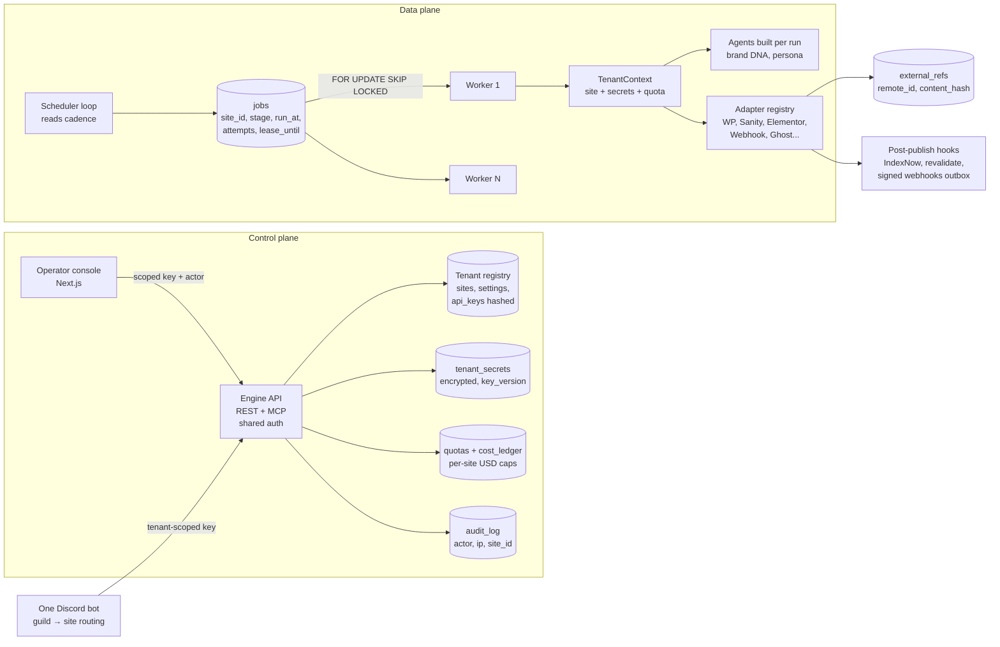

# ContentFTE — Gap, Bug & Improvement Plan (2026-11-01)

**Scope:** whole repo at `2a068cf` (engine, agent pipeline, adapters + SDK, SEO subsystems, operator console, multi-instance / multi-tenant ops) plus the live output on owaisabdullah.dev.
**Method:** 6 code explorers (Sonnet 5.5), 3 `claude-seo` live-page audits (schema, GEO, content), the `seo-pack` tactic library as rubric, a focused `security-audit` pass (2 agents), context7 (Next.js, OpenAI Agents SDK), web research for the 2026 SEO baseline. Plan and verification by Opus 5.5. Tavily MCP failed to connect this session; other search tools were used instead.
**Companion docs:** builds on (doesn't replace) `pipeline_flow_and_state.md` (ranked gaps), `instances-isolation.md`, `incident_ledger.md`, `console-ux-audit.md`, `TASKS.md`.

---

## 0. How to read this

| Field | Meaning |
|---|---|
| **Severity** | Critical / High / Medium / Low. Security items use the security-audit anchors: *critical* = unauthenticated takeover of data or publishing; *high* = an explicit control fully defeated with real consequences (auth bypass, cross-tenant read/write, publishing without approval); *medium* = real violation, limited blast radius. |
| **Status** | ✅ **Verified** — lead re-read the code path or re-fetched the live page. 🔎 **Reported** — an explorer read the code path; not re-verified by lead (treat as high-confidence, confirm while fixing). 🧪 **Needs validation** — depends on a deployment/runtime fact the repo can't show. |
| **IDs** | `SEC` security · `ENG` engine core · `PIPE` agent pipeline · `ADP` adapters/SDK · `SEO` SEO & content quality · `FE` live frontend (separate repo) · `CON` console · `TEN` tenancy · `OPS` operations. |

Known-in-docs items are marked *(known)* so they aren't rediscovered as new.

---

## 1. Executive summary

1. **Isolated mode (one engine process per site) works for 1–3 sites. Shared mode (`TENANCY_MODE=shared`) is not safe for client data.** Auth is one master key that fails open, article/keyword ids are never checked against a site, ~15 code paths read process env or import-time globals where they should read the site, and WP credentials fall back to the env of whichever process runs the request.
2. **The engine has an open door.** `/mcp` is mounted with no authentication, and `GET /sites` (and MCP `list_sites`) return every site's WordPress application password in plaintext — which the console then pre-fills into browser state and an "Export Config" download. The human approval gate is also weaker than it looks: agents that read untrusted web content hold a generic sheet writer that can set the approval column (SEC-17), and the Discord bot accepts approvals, stage triggers and live-post edits from anyone in the server (SEC-18). The previously leaked Google SA key is still reachable in two local branches and its rotation is unconfirmed (SEC-22).
3. **Quality gates are mostly prompt-level.** The deterministic eval gate (`lib/eval_gate.check_gate`) has no production caller; the fact-check tool is registered under a different name than the prompt uses and its matcher accepts any digit substring; link validation runs only inside WP publish. Live proof: the article the engine scored **94** teaches an OpenAI Agents SDK handoff pattern that is wrong (checked against current SDK docs via context7).
4. **The live site has a cannibalization problem the engine can't see:** ~13 clusters across 76 posts (e.g. 6 Gemini-3 posts, 2 Plaud, 2 "autonomous AI employees via MCP"). `dateModified` never differs from `datePublished`, and the robots.txt `Disallow` rules only apply to `Applebot-Extended`.
5. **The console promises per-site control the engine doesn't honour.** Image, content, indexing and notification settings are saved but never read; `max_posts_per_cadence` is never enforced; `enforce_cadence` is never sent. Saving settings also writes blank WP credentials that disable the env fallback, and every successful save shows an error toast (redirect inside `try/catch`).
6. **Scheduling is still the single-site GitHub Actions pipeline.** It can't address a site, can't express per-site cadence, and its concurrency group silently drops queued runs.
7. **Adapters have no common contract.** WP output allows `javascript:` links and `</script>` breakout in JSON-LD; Sanity silently no-ops on `_id` collision and can't publish as draft; the custom-site webhook is unsigned and unwired.
8. **Recommended direction: hybrid multi-tenancy** — one shared engine + Postgres job queue + worker pool, per-tenant encrypted secrets, per-tenant scoped API keys and quotas, with isolated mode kept as an option for clients who need their own database (§4).

### Top 10 actions (in order)

| # | Action | IDs | Effort |
|---|---|---|---|
| 1 | Authenticate `/mcp`; make the SDK key fail closed with constant-time compare | SEC-01, SEC-02 | S |
| 2 | Redact secrets from every API response; write-only secret inputs in the console | SEC-04 | S |
| 3 | Fix WP render XSS (`javascript:` scheme, JSON-LD `<` escape) and sanitize SDK HTML fallback | SEC-06 | S |
| 4 | Rotate the leaked SA key; Discord user allow-list; take the sheet writer away from web-reading agents | SEC-22, SEC-18, SEC-17 | S |
| 5 | Console: redirect outside `try`, PATCH-style settings save that never blanks secrets | CON-01, CON-04 | S |
| 6 | Shared mode: no env fallback for WP creds; `site_health` uses site creds; `/run/{stage}` passes site explicitly | TEN-01, SEC-08, ENG-05 | S |
| 7 | Decay job: skip a page when either GSC window fails; per-site property; minimum-click floor | SEO-03 | S |
| 8 | Wire `check_gate` + fixed fact-check + link validation into every path that can reach `approved` | SEO-01, SEO-02, PIPE-01 | M |
| 9 | Full JSON-LD `@graph` + real `modified_at` + image/alt fixes | SEO-07, SEO-08, SEO-23 | M |
| 10 | Start Phase 2 (TenantContext, scoped keys, encrypted secrets) before onboarding a second client | §5 | L |

---

## 2. Phase 0 — stop-the-bleed checklist (≈1 week, no architecture change)

Each item is small, independently shippable, and should land with a regression test.

- [x] **SEC-01** Put one ASGI auth middleware in front of `/mcp` (reuse the REST key check). `main.py:102` — **DONE: `sdk/auth.py` `KeyAuthMiddleware` fronts `/mcp` (X-Site-Key or Bearer)**
- [x] **SEC-02** Refuse to boot (or 503) when `SDK_MASTER_KEY` is unset unless `DEV_OPEN=1`; `hmac.compare_digest` for both SDK and legacy `API_KEY`. `sdk/server.py:73-78`, `main.py` — **DONE: fail-closed 503 when `SDK_MASTER_KEY` is unset (local dev opts in with `SDK_ALLOW_UNAUTHENTICATED=1`); constant-time compare on SDK, MCP and legacy `API_KEY`**
- [~] **SEC-04** `list_sites`/MCP return `has_wp_password: true`-style flags, never secret values; console secret inputs are blank "leave empty to keep"; strip secrets from Export Config. `sdk/service.py:106`, `console/app/(console)/sites/[slug]/site-cadence-settings.tsx:84,101,106`, `console/app/(console)/sites/sites-client.tsx:37-38` — **PARTIAL 2026-11-01: console side done** (`engine()` strips secrets from every site response, client form no longer receives/prefills them, Export Config is redacted, secret inputs are write-only with an opt-in "remove" tick). **Still open: redact in the engine** (`sdk/service.py:106`) so MCP and other API clients stop receiving them, and note the engine's top-level-only `settings` merge means the console must keep merging per group (or the engine should deep-merge).
- [x] **SEC-06** `wp_render`: allow only `http`, `https`, `mailto`, relative and `#` hrefs; JSON-LD replaces `<` with `<`; SDK runs the HTML fallback through the same sanitizer. `lib/wp_render.py:66-72,388-391`, `sdk/ContentFTEArticle.tsx:179-181` — **DONE for the WP renderer: URL scheme allow-list + JSON-LD `<`/`>`/`&` escaping (`lib/wp_render.py`). Still open: the SDK React renderer's raw-HTML fallback (`sdk/ContentFTEArticle.tsx:179`)**
- [ ] **SEC-07 / SEC-18** Discord: `ALLOWED_DISCORD_USER_IDS` (or role) enforced on reactions, slash commands (`interaction_check`) and `on_message`; require `message.author.id == bot.user.id` for drafts; bind approvals to a row id not title text. `discord_bot/bot.py:1503-1556,1726`
- [ ] **SEC-17** Take the generic `manage_sheet_data_tool` away from agents that read web content (or guard its wrapper: no writes to `Approve/Disapprove`/`Published`, no `clear_sheet`/`delete_row`, `RAW` input). `tools/sheet_tool.py:1704`
- [ ] **SEC-22** Rotate/delete the leaked Google SA key in GCP IAM; delete local branches `Extending-AgentRunner` and `backup-bb314a6`; expire reflog + gc.
- [ ] **SEC-23** `permissions: contents: read` on every workflow; move `log_coverage` write access to its own job; secrets into a `master`-only Environment.
- [ ] **SEC-24** Refresh `uv.lock` (fastapi → starlette ≥ 0.49.1, pillow ≥ 12.3.0, urllib3 ≥ 2.6, requests ≥ 2.33); lock `discord_bot` deps.
- [x] **SEC-08 / TEN-01** In shared mode `_wp_config` raises instead of falling back to `WP_*` env; `site_health` uses `_wp_config(site)`. `sdk/service.py:1073-1077,2795,2843` — **DONE: `_wp_config` has no env fallback in shared mode; `site_health` uses the site's own credentials**
- [ ] **SEC-11** Remove secret-bearing logs: Sanity request-body prints and DEBUG header logs, IndexNow `apikey=` in URLs/errors, full tool-result prints in `blog_agent/hooks.py`.
- [ ] **SEC-12** Add `.dockerignore` (`.env`, `*.db`, `google-credentials.json`, `.git`, `.venv`, `data/`, `.test-tmp-*`) or delete the stale root `Dockerfile`.
- [x] **ENG-01** Define `logger` in `sdk/service.py` (the error path of `run_instant_pipeline` raises `NameError`). `sdk/service.py:883-891` — **DONE: `logger` defined in `sdk/service.py`**
- [x] **ENG-02** One publish-mode enum (`draft`/`publish`) normalized at the service boundary; REST, MCP and TS SDK agree. `sdk/server.py:105`, `lib/wordpress.py:368`, `sdk/contentfte.ts:171` — **DONE: `publish`/`live`/`auto` all mean live (`lib/wordpress.py::is_live_mode`, service + MCP enum)**
- [~] **ENG-05** `/run/{stage}`: stop mutating `os.environ["SITE_SLUG"]` (nothing reads it); pass `site_slug` explicitly; lock key = `(stage, site)`; share one lock registry with MCP. `sdk/server.py:517-550`, `mcp_server/server.py:42` — **PARTIAL, deliberately different from the plan text:** removed the racy no-op `os.environ["SITE_SLUG"]` mutation, REST and MCP now share ONE single-flight registry, and `site_slug` responses carry an explicit warning. The lock stays per-stage (not per-site) because stage handlers still run against the instance's configured site — keying it by site would let two identical runs hit the same site. True per-site stages need the Phase 2 `TenantContext`.
- [x] **ENG-11** `delete_site` deletes `BrandProfile`, `ShareOfVoice`, `TavilyUsage`, site-level `CostLedger` first (or `ON DELETE CASCADE`) and writes an audit row. `sdk/service.py:230-256` — **DONE: `delete_site` clears BrandProfile/ShareOfVoice/TavilyUsage/CostLedger and writes a `site.deleted` audit row**
- [x] **CON-01** Move `redirect()` out of `try/catch` (or rethrow `isRedirectError`). `console/actions/instances.ts:84,221,236`, `console/actions/articles.ts` (`createArticleAction`) — **DONE 2026-11-01: redirects moved out of try/catch in `actions/instances.ts` + `actions/articles.ts`**
- [x] **CON-04** Settings save sends only changed groups; empty secret = unchanged; never write `wp` with blank credentials. `console/actions/instances.ts:173-200` — **DONE 2026-11-01: per-group merge, blank secret = keep, only submitted groups touched, WP group never created from a pre-filled base URL; also fixed the tab bug below**
- [x] **SEO-03** Decay job: if either window's GSC call fails, skip the page (don't score 0); pass the per-site property; minimum prior-clicks floor. `scripts/decay_job.py:38-95`, `lib/search_console.py:102-105` — **DONE: failed Search Console query skips the page (never scored as 100% decay); per-site property; published-URL lookup; minimum-prior-clicks floor; clear 'no sites in <db>' diagnosis**
- [x] **PIPE-01 (part 1)** `function_tool(run_factcheck_gate, name_override="factcheck_gate_tool")` + a test that every tool named in a prompt exists on that agent. `tools/factcheck_tool.py:91` — **DONE: `name_override="factcheck_gate_tool"`. The tool-name contract test across ALL agents is still to do**
- [x] **ADP-13** Fix or delete `lib/gbp.py` (doesn't compile on Python 3.13). `lib/gbp.py:114` — **DONE: `lib/gbp.py` now compiles AND imports (a second, unrelated regex bug was hiding behind the f-string error)**
- [ ] **FE-01** (frontend repo) Move the `Disallow` lines into the `User-agent: *` group — but **don't** disallow `/_next/` for Googlebot (it blocks JS/CSS rendering).
- [x] **OPS-04** Console refuses to start when `OPERATOR_PASSWORD`/`SESSION_SECRET` equal the `.env.example` placeholders or the secret is < 32 chars. — **DONE 2026-11-01: `lib/env.ts` throws in production on placeholder/short secrets, warns in dev**

---

## 3. Findings by area

### 3.1 Security (`SEC`)

| ID | Sev | Status | Finding | Where | Smallest fix |
|---|---|---|---|---|---|
| SEC-01 | Critical 🧪 | ✅ | `/mcp` is mounted with no authentication. Any client that can reach the engine can run every MCP tool: publish, edit, delete, run stages, and `list_sites` (which returns WP passwords, see SEC-04). Critical if any engine is reachable beyond localhost — confirm each instance's exposure. | `main.py:102`, `mcp_server/server.py` | Shared ASGI auth middleware for REST, MCP and legacy routes. |
| SEC-02 | High | ✅ | `_check_site_key`: `if expected and x_site_key != expected` — unset key = every route open (including DELETE site and `/run/{stage}`); `!=` is not constant-time. Legacy `main.py` `API_KEY` also uses `!=`. | `sdk/server.py:73-78`, `main.py:~97-125` | Fail closed outside `DEV_OPEN=1`; `hmac.compare_digest`. |
| SEC-03 | High | 🔎 | No key→site binding. `Site.api_key` is never checked; every id-based route loads with `s.get(ArticleModel, id)` and no site check. Any key holder can read/approve/publish/delete any tenant's article in shared mode. `TASKS.md:111` claims per-site keys exist — they don't. | `sdk/server.py` (all `/articles/{id}/*`, `/keywords/{id}`), `sdk/service.py` | `AuthContext(site_id \| platform)` dependency + single `_load_article()` / `_require_site()` choke points (Phase 2). |
| SEC-04 | High | ✅ | Secrets leave the engine: `list_sites` returns raw `settings` (WP `app_password`, IndexNow/Bing keys, Discord webhook). The console passes them as props to a `"use client"` component (`useState(String(wpSettings.app_password))`) and "Export Config" downloads them all. Secrets also enter LLM context via MCP. | `sdk/service.py:106`; console files in Phase 0 | Redact on output; write-only fields; encrypted storage (Phase 2). |
| SEC-05 | High | 🔎 | SSRF / unbounded fetches: `test_wp_connection` sends caller-supplied Basic creds to a caller-supplied URL and returns the error text; `site_health`, `_download_image`, Sanity image upload (no timeout; also uploads any **local file path** that exists), `post_to_sanity_tool` (`requests.get` with no timeout) and the console instance `baseUrl` all fetch without host checks. A model-chosen image URL like `http://169.254.169.254/...` is fetched server-side. | `sdk/service.py:1096-1112,2206,2811`, `lib/sanity_adapter.py:649,1076,1126`, `tools/tools.py:1873`, `console/lib/instances.ts:86-104` | One `safe_fetch()` (resolve + block private/link-local ranges, cap redirects and size, sniff type); reuse `tools/screenshot_tool.py::_url_is_safe_public`. Never accept local paths from content. |
| SEC-06 | High | ✅ | Stored XSS in WP output: link hrefs are only `html.escape`d (no scheme allow-list) so `[x](javascript:...)` survives; `jsonld_script` uses `json.dumps` without escaping `<`, so `</script>` in a title/FAQ closes the tag. Untrusted web research flows into drafts, so this is reachable via prompt injection. SDK's `dangerouslySetInnerHTML={{__html: content.html}}` is unsanitized. | `lib/wp_render.py:66-72,388-391`, `sdk/ContentFTEArticle.tsx:179-181` | Scheme allow-list; `<` in JSON-LD; sanitize HTML fallback. |
| SEC-07 | High 🧪 | ✅ | Discord approvals: the reaction handler checks channel + emoji only — no approver allow-list, and the message isn't required to be the bot's. Anyone in the channel can approve a post or enqueue a topic; a human can post `**Title:** X` and react ✅. Severity depends on who can see the approval channel. | `discord_bot/bot.py:1503-1560` | Allow-list + bot-author check + row-id binding. |
| SEC-08 | High | 🔎 | `site_health` authenticates with process `WP_USERNAME`/`WP_APP_PASSWORD` against `site.base_url` — in shared mode tenant A's password is sent to tenant B's host. | `sdk/service.py:2795,2843-2845` | Use `_wp_config(site)`. |
| SEC-09 | Medium | ✅ | Console middleware only checks that a `console_session` cookie exists; `requireSession()` runs in the layout and 3 pages only. Next.js docs: layouts don't re-run on client navigation and page segments can be requested alone, so page data relies on an unverified cookie. | `console/middleware.ts:12-14`, most `app/(console)/**/page.tsx` | Verify the session inside `engine()`/`currentInstance()` (data-access layer), memoized with `cache()`; HMAC check in middleware too. |
| SEC-10 | Medium | 🔎 | Console login: no rate limit or lockout; error text names `OPERATOR_PASSWORD`; 7-day token with no revocation; `next` param accepts `/\evil.com` (open redirect). | `console/actions/auth.ts:8-16`, `console/app/login/page.tsx:16` | Limiter + generic message + session version; `new URL(next, origin).origin === origin`. |
| SEC-11 | Medium | 🔎 | Secrets/content in logs: Sanity adapter prints request bodies and logs headers (Bearer token) at DEBUG; IndexNow puts `apikey=` in the URL and returns it inside error strings; `hooks.py` prints every tool result into public Actions logs. | `lib/sanity_adapter.py:197-199,408,516`, `lib/indexing.py:103,115`, `blog_agent/hooks.py` | Redacting logger; key in header; log tool names + sizes only. |
| SEC-12 | Medium 🧪 | 🔎 | No `.dockerignore`; root `Dockerfile` does `COPY . .`, so a local build bakes `.env`, `google-credentials.json` and the SQLite DBs into image layers. Matters only if the image is built/pushed. | `Dockerfile:18` | `.dockerignore` or delete the file. |
| SEC-13 | Medium | 🔎 | Webhooks: custom-site push has no HMAC, timestamp, delivery id or retry; Sanity revalidate webhook accepts the secret in the query string and compares with `===`; IndexNow fire-and-forget is killed on serverless. | `lib/custom_site.py:73-93`, `sdk/sanity/webhooks/revalidate.ts:23-46,83-86,138` | `X-CFTE-Signature: t=..,v1=HMAC(ts.body)`; `timingSafeEqual`; `after()`/`waitUntil`. |
| SEC-14 | Medium | 🔎 | Plaintext secrets at rest: `Site.settings.wp.app_password` in DB JSON; engine API keys in `console/instances.json` (gitignored, unencrypted). | `lib/db.py` (Site.settings), `console/lib/instances.ts:45-61` | `tenant_secrets` table encrypted with a master key outside the DB (Phase 2). |
| SEC-15 | Low | 🔎 | Hardening: no security headers in `next.config.ts`; engine CORS defaults to `*` (and omits DELETE/PUT); OpenAPI docs unauthenticated; media proxy allows `name=".."` and forwards upstream content-type. | `console/next.config.ts`, `main.py:~90`, `console/app/api/media/[id]/[name]/route.ts:15-30` | Headers + CSP; explicit CORS origins; filename allow-list + `nosniff`. |
| SEC-16 | — 🧪 | *(known E14)* | Historically leaked Google SA key: scrubbed from `master`, rotation in GCP IAM never confirmed — and still reachable in local branches (see SEC-22). | `docs/incident_ledger.md` | Owner rotates the key in IAM. |

> **SEC-17 – SEC-24** — results of the focused security-audit pass (prompt-injection blast radius, Discord authorization, CI/supply chain, dependency advisories, leaked-key history) are in §3.1a below.

### 3.1a Focused security review addenda

From the two security-audit agents (prompt-injection / bot boundaries; CI / supply chain / secrets). Each finding names the lower-trust principal, the crossed control and the concrete result; 🧪 items have no severity until the missing deployment fact is confirmed.

| ID | Sev | Status | Finding (principal → crossed control → result) | Where | Smallest fix |
|---|---|---|---|---|---|
| SEC-17 | Medium (High when WP `auto`) | ✅ | **Prompt injection can self-approve a draft.** A web-page/forum author whose text reaches Tavily/Reddit/PAA results can steer agents that hold `manage_sheet_data_tool` — a generic sheet writer with no worksheet allow-list, no column deny-list and no action limit. The model can set `Approve/Disapprove` on `generated_posts`, bypassing the Discord gate; the scheduled `post` stage then publishes it (Sanity lands as a Studio draft; WP `auto` goes live). `value_input_option` defaults to `USER_ENTERED`, so `=IMPORTDATA(...)` formulas also execute (exfiltration). | `tools/sheet_tool.py:923,1485,1704`; attached at `blog_agent/blog_agents.py:194,450,915`, `blog_agent/posting_agent.py:168,250` | Remove the generic sheet tool from agents that also read web content; if one must stay, the `@function_tool` wrapper denies writes to `Approve/Disapprove` and `Published`, denies `clear_sheet`/`delete_row`, and forces `RAW`. |
| SEC-18 | 🧪 | ✅ | **Discord bot has no user authorization on any surface** (extends SEC-07): reactions (any member approves/rejects by exact title match), slash commands `/run` (dispatches the GitHub workflow with the owner's `GITHUB_PAT`), `/edit` (edits the live Sanity post), `/repurpose`, `/add_topic`, and `on_message` — every non-bot message in any channel or DM reaches `_discord_agent`, which holds approval, publish-flag, stage-trigger and live-edit tools. The code comment assumes "this server only ever has the owner and the bot in it". Missing fact: who is in the guild(s) and whether the bot is invited elsewhere. | `discord_bot/bot.py:1286-1295,1391-1405,1503-1556,1726-1738` | `ALLOWED_DISCORD_USER_IDS` (or role) enforced in `on_raw_reaction_add`, `bot.tree.interaction_check` and the top of `on_message`; `@app_commands.guild_only()`; channel allow-list for `on_message`. |
| SEC-19 | Medium | 🔎 | **Screenshot SSRF guard runs once, before navigation.** A page owner can 302 / meta-refresh / iframe / DNS-rebind to `127.0.0.1`, `169.254.169.254` or RFC1918 (including the engine's own unauthenticated `/mcp`). The PNG can be inserted into the post **after** human approval, so nobody reviews it. | `tools/screenshot_tool.py:15-39,87`, `blog_agent/image_agent.py:142,175-187` | `page.route("**/*")` re-validates every request (scheme + resolved IP). |
| SEC-20 | Low | 🔎 | **Model-chosen fetch URLs enable data exfiltration.** Injected text can make `fetch_url_title` / `tavily_extract` / `tavily_crawl` request `https://attacker/?d=<context>` — leaking unpublished drafts, brand DNA, offer catalog or brain notes. (No path to env secrets found.) | `tools/search_tools.py:148-164`, `blog_agent/research_agent.py:227` | Drop `fetch_url_title` from agents that see untrusted text; restrict Tavily URL tools to hosts returned in this run's search results. |
| SEC-21 | Low | 🔎 | **Second-order injection via `brain/`.** `log_coverage` commits LLM-drafted summary text into `brain/`, which later re-enters generator context via `get_brain_notes_tool` (which also reads across sites, ENG-08). Runs after human approval, so impact is persistence, not bypass. | `scripts/run_stage.py:2146-2250`, `tools/tools.py:333` | Coverage rows to the DB as data, never re-fed as instructions; site-scoped reads. |
| SEC-22 | 🧪 | ✅ | **Leaked Google SA key (E14) still reachable in local history.** Commit `11ec1cb` (`contentspark-service-account-key.json`) is still reachable from local branches `Extending-AgentRunner` and `backup-bb314a6` (not from `master`/`origin/master`; the only remote branch is `origin/master`). Anyone with this clone, or any remote that ever received those branches, can recover the key; rotation is unconfirmed. | git history | **Rotate/delete the key in GCP IAM now**; delete both branches; `git reflog expire --expire=now --all && git gc --prune=now`. |
| SEC-23 | 🧪 | 🔎 | **CI secret exposure depends on repo settings.** `test-search-console.yml`, `check-models.yml` and the `deploy` job have no `permissions:` block; `pipeline.yml:104` grants `contents: write` to the whole job that runs LLM agents over web content with ~20 secrets. A user with write access can dispatch an edited workflow from a branch and read every secret. Missing facts: repo- vs Environment-scoped secrets, default `GITHUB_TOKEN` permission, who has write, branch protection. | `.github/workflows/*.yml` | Secrets in Environments restricted to `master` with reviewers; `permissions: contents: read` everywhere; `log_coverage` in its own job with write; `persist-credentials: false`; pin actions by SHA. |
| SEC-24 | Low | ✅ | **Vulnerable locked dependencies.** `starlette 0.47.1` (CVE-2025-62727 Range-header DoS, fixed 0.49.1; reachable via `FileResponse` image serving, blocked by `fastapi 0.116.1` pinning `<0.48`); `pillow 11.3.0` (CVE-2026-25990, CVE-2026-54058 — vulnerable by version, reachability on remote bytes not traced); `urllib3 2.5.0` (CVE-2025-66418 decompression chain, fixed 2.6.0; reachable when fetching third-party URLs); `requests 2.32.4` (CVE-2026-25645, in range but not reachable). `discord_bot/requirements.txt` is unpinned with no lockfile. Console `next 15.5.27` / `react 19.3.0` not affected by the advisories checked (one RSC DoS advisory, GHSA-q4gf-8mx6-v5v3, has no confirmed fixed version — verify). | `uv.lock`, `discord_bot/requirements.txt`, `console/package-lock.json` | Bump fastapi (→ starlette ≥ 0.49.1), pillow ≥ 12.3.0, urllib3 ≥ 2.6, requests ≥ 2.33; lock the bot deps; add `pip-audit` + `npm audit` + Dependabot/Renovate to CI. |

**Checked and clean** (so they don't get re-audited): no `pull_request_target`/`workflow_run`/`issue_comment` triggers; free-text workflow inputs pass through `env:`, not `run:`; no self-hosted runners; no `eval`/`exec`/`pickle`/unsafe `yaml.load`/`shell=True`/archive extraction in project source (only `subprocess` is fixed-arg `git` in `run_stage.py`); no real secrets in tracked files or in history beyond SEC-22; `.env`, `google-credentials.json`, `*.db`, `data/`, `console/instances.json` are gitignored; the Sanity Portable Text path whitelists tags and link schemes (only the WP renderer has the SEC-06 gap); `get_article_image` uses a name allow-list (no traversal); legacy `main.py` routes all require `API_KEY` and fail closed when it's unset (only `/`, `/health` and the OpenAPI docs are public).

**Prompt-injection blast radius**

| Untrusted source | Agent | Dangerous tools | Human gate in between? |
|---|---|---|---|
| Tavily search/extract/crawl, SERP, PAA, Reddit/Quora | `researcher_agent` | `fetch_url_title` (SEC-20); output written deterministically | n/a — poisoned research flows downstream |
| Same + research row | `brief_agent` | generic sheet writer (SEC-17), Tavily | none before the brief is written |
| Same + brief | `content_generator_agent` / evaluator | generic sheet writer → **can self-approve** (SEC-17), Tavily | Discord ✅ — weakened by SEC-17 and SEC-18 |
| Draft text + external links | `preparation_agent` → `contextual_image_insertion_agent` | screenshot (SEC-19), image generation | **none** — images chosen after approval |
| Approved row | `posting_agent` | `post_to_sanity_tool` with model-set `content`/`image_path` (SEC-05/06) | text approved by a human; Sanity draft still gated in Studio; WP `auto` has no second gate |
| Discord users | `_discord_agent` | approval, publish-flag, stage-trigger, live-edit | **none** (SEC-18) |

**Secrets-management target state** (feeds Phase 2): secrets out of `settings` JSON into an envelope-encrypted `tenant_secrets` table (or Doppler/Infisical); write-only through the API (`has_*` + last-rotated); per-site hashed keys resolving to exactly one `site_id`; per-tenant runtime env (job gets only its tenant's secrets); GCP workload identity instead of long-lived SA JSON; 90-day rotation runbook; central log redaction filter (`Authorization`, `X-Site-Key`, `*_KEY`, `*_TOKEN`, `*password*`, credentialed URLs); `gitleaks`/`trufflehog` in CI + GitHub push protection; lockfiles for every deployable, `--frozen` builds, digest-pinned base images.

### 3.2 Engine core (`ENG`)

| ID | Sev | Status | Finding | Where | Fix |
|---|---|---|---|---|---|
| ENG-01 | High | ✅ | `logger` used but never defined in `sdk/service.py` → `NameError` on every `run_instant_pipeline` failure; the except handler re-raises so the background task loses the error. | `sdk/service.py:883,888,891` | `logger = logging.getLogger(__name__)`. |
| ENG-02 | High | ✅ | REST `mode="publish"` (documented `draft \| publish`) creates a WP **draft** — the connector only treats `"auto"` as live — while the article is marked published. MCP uses `draft \| auto`. | `sdk/server.py:105` vs `:135`, `lib/wordpress.py:368`, `sdk/contentfte.ts:171` | One enum, normalized once. |
| ENG-03 | High | 🔎 | Duplicate WP posts: the `wp_post_id` check runs before the remote call and is persisted after it; no row claim. Double-click, console retry, or a crash between remote create and commit → second post (renamed `-2` by the slug guard; the computed `duplicate` flag is ignored). | `sdk/service.py:2314,2457-2461`, `lib/wordpress.py:290-299` | Atomic `publish_state` claim (`UPDATE … WHERE state='idle'`) + look up by slug / `_cfte_article_id` meta before create. |
| ENG-04 | High | 🔎 | `generate_content`: no single-flight per article; token usage read from module-global `LAST_USAGE` (concurrent runs mix costs across tenants); cost only ledgered on success; a sync DB session held open across a 30–120 s `await`. | `sdk/service.py:1524-1737`, `blog_agent/generation.py:20,70,92` | Return usage from the call; ledger in `finally`; per-article claim; short sessions. |
| ENG-05 | High | ✅ | `/run/{stage}` accepts `site_slug` but only sets `os.environ["SITE_SLUG"]`, which nothing reads → always runs the default site; env mutation races between threads; lock is per stage (site A blocks site B); MCP keeps a separate `_running_stages` so a stage can run twice. | `sdk/server.py:517-550`, `mcp_server/server.py:42` | Explicit site argument; `(stage, site)` lock in a shared (later DB) registry. |
| ENG-06 | High | 🔎 | MCP tools are `async def` but call sync service functions (WP, images, IndexNow) directly — each MCP call blocks the event loop for the whole process, REST included. | `mcp_server/server.py` (e.g. `publish_article` ~`:412`) | `await asyncio.to_thread(...)`. |
| ENG-07 | High | 🔎 | `upsert_keyword` overwrites intent/volume/difficulty/priority with defaults on re-submit — re-submitting a keyword erases its research and queue position. | `lib/ledger.py:88-94` (called from `sdk/service.py:917`) | Only overwrite explicitly passed fields. |
| ENG-08 | High | 🔎 | Unknown or empty `site_slug` returns **all tenants'** data for brain entries, review feedback, `mine_feedback`, spend summary. `get_brain_notes` also includes `site_id=NULL` rows and the repo `brain/*.md` for every site, and the tool calls it with no site → one tenant's first-hand stories can surface in another's draft. | `sdk/service.py:787-791,1844,1873,1928,2017,2059`, `tools/tools.py:345` | `_require_site(slug)` rejects unknown/empty; brain strictly per site. |
| ENG-09 | Medium | 🔎 | `list_logs` / `list_stages` have no site filter; `record_stage_run` writes no `site_id`. | `sdk/service.py:735-771,842-875` | Add `site_id` + filter. |
| ENG-10 | Medium | 🔎 | `approve_article` has no state guard (can regress `published`→`approved`, approve content-less briefs) and emits `article.published`; `generate_content(regenerate=True)` on a published article resets to `drafted` and the next publish takes the dedupe path without updating WP. | `sdk/service.py:1686,1809,1826` | Explicit state-transition table. |
| ENG-11 | Medium | 🔎 | `delete_site` leaves FK-referenced rows → 500 on Postgres; no audit row. `delete_article` deletes cost/audit rows despite its docstring. | `sdk/service.py:230-256` | Cascade or soft delete; keep accounting rows. |
| ENG-12 | Medium | 🔎 | Check-then-insert races (`submit_article`, `upsert_site`, `get_or_create_site`, `upsert_keyword`); no unique `(site_id, keyword_id)` on articles; Tavily meter read-modify-write loses increments and fails open; `cost_ledger.finalize` can double-write totals. | `sdk/service.py:904-935`, `lib/store.py:200`, `lib/tavily_meter.py:45-79` | Unique constraints + `INSERT … ON CONFLICT`; `UPDATE … SET calls = calls + 1 WHERE calls < :budget`. |
| ENG-13 | Medium | 🔎 | Read paths have write side effects: `get_or_create_site` on reads and `submit_article` auto-create a site from any typo'd slug. | `sdk/service.py:905-909`, `lib/store.py:200` | Sites only via `POST /sites`; validate slugs. |
| ENG-14 | Medium | 🔎 | Idempotency cache is an in-process dict (no TTL despite the docstring, no cap, per-worker under `--workers 2`, racy), and covers only `POST /articles`. | `sdk/server.py:70,146-161`, `Dockerfile:26` | DB `idempotency_keys` table; header on every mutating route. |
| ENG-15 | Medium | 🔎 | `init_db()` runs `create_all` on every service call (extra round-trips on Neon); no Alembic, so column changes never reach existing Postgres; no SQLite WAL/`busy_timeout`; SQLite returns naive datetimes so API timestamps differ by backend. | `lib/db.py:293-320`, `sdk/service.py:73` | Init once; Alembic + schema-version check; UTC `TypeDecorator`. |
| ENG-16 | Medium | 🔎 | Error envelope: every service error → 404; publish picks codes by substring; MCP keeps a `next` hint REST drops. | `sdk/server.py:81-85,238-242` | Typed `ServiceError(code, http, message, next)`. |
| ENG-17 | Medium | 🔎 | Input hygiene: untyped `patch_meta(body: dict)`; unclamped `limit` (negative = unlimited on SQLite, 500 on PG); no offset on queue/research; unescaped `LIKE`; `int(settings[...])` raises on bad settings and breaks publish/health. | `sdk/server.py`, `sdk/service.py` | Pydantic models + bounds. |
| ENG-18 | Medium | 🔎 | `article_stats` (every dashboard hit) loads every article's `content_md` + `meta` and aggregates in Python; same for `has_images`/`sort=quality`. | `sdk/service.py:477-480` | SQL aggregates / `load_only`. |
| ENG-19 | Medium | 🔎 | Both clients retry 4xx (401/404/409/422) because `raise_for_status()`/`!res.ok` is inside the retry `try`; non-idempotent POSTs retried without idempotency keys; TS client has no timeout; Python client doesn't URL-encode query strings. | `sdk/python_client.py:48-55`, `sdk/contentfte.ts:126-147` | Re-raise 4xx; idempotency key on all POSTs; `AbortSignal.timeout`. |
| ENG-20 | Low | 🔎 | Publish in `draft` mode still sets `status=published`, `published_at`, and pings IndexNow/Bing for a draft URL; `require_approval=False` has no effect. | `sdk/service.py:2415,2477-2486` | Separate `published_draft` state; ping only on live. |
| ENG-21 | Low | 🔎 | Observability: `/health` always OK (no DB check), no readiness probe, no request id, `print()` in places. | `main.py:204` | `/ready` + request-id middleware + JSON logs with `site_id`/`article_id`. |
| ENG-22 | Low | 🔎 | `sdk/service.py` is 3,118 lines and REST/MCP duplicate stage-run logic. Natural seams: `sites`, `articles`, `generation`, `images`, `publish`, `elementor`, `brain`, `reports`, `_common`. | `sdk/service.py` | Split during Phase 2; generate MCP tools from one operation registry. |

### 3.3 Agent pipeline (`PIPE`)

| ID | Sev | Status | Finding | Where | Fix |
|---|---|---|---|---|---|
| PIPE-01 | High | ✅ | The "mandatory" fact-check gate isn't enforced: `function_tool(run_factcheck_gate)` registers the tool as `run_factcheck_gate` but prompts say `factcheck_gate_tool` (the model may or may not infer it); no code path calls `gate_factcheck`; the matcher accepts a claim if its digit string appears anywhere in the corpus (so "5%" passes on any "5"); `ATTRIBUTION_RE` lacks word boundaries ("per" inside "experience"); named entities/model names/API behaviour are never extracted; excerpts come from the model itself. | `tools/factcheck_tool.py:91`, `blog_agent/blog_agents.py:356,428`, `lib/factcheck.py:21,56-57` | `name_override`; deterministic call in `run_content` and the service path with excerpts taken from tool outputs; whole-number + unit matching; entity/version claim extraction. |
| PIPE-02 | High | 🔎 | The nested evaluator (`content_evaluation_agent.as_tool()`) runs through the inherited `Runner.run`, not `run_with_fallback` — pinned to one OpenRouter model with no fallback or usage accounting. If it 429s the generator proceeds blind. | `blog_agent/blog_agents.py:199-203`, `blog_agent/custom_runner.py` | Override `run()` to delegate to the fallback runner (re-entrancy guard). |
| PIPE-03 | High | 🔎 | The generator may skip the evaluator when Jev `publish_ready` is true, and the evaluator returns its best draft after 3 rounds even below 90 — a draft can ship on a cheap classifier alone. | `blog_agent/blog_agents.py:~365` | Remove the skip above a stakes threshold; enforce floors in code (SEO-01). |
| PIPE-04 | High | 🔎 | Posting is LLM-driven: the agent echoes the article into `post_to_sanity_tool`, derives the slug, writes `Published=Yes` and the `published_posts` row, and the prompt says a failed sheet update isn't a failure. Prep always picks row 2 → if the flag never flips, tomorrow republishes; LLM slugs defeat slug idempotency. | `blog_agent/posting_agent.py:~60,~223-235,~570`, `scripts/run_stage.py:1294` | Slug in Python; flag + row written in `run_posting_workflow` after a confirmed `post_id`. |
| PIPE-05 | High | 🔎 | Head-of-line blocking: content always takes the first `Generated=No` brief, post always row 2; a poison row burns a generation daily and blocks the queue. No attempts counter or quarantine. | `scripts/run_stage.py:1203-1292` | `attempts` + `quarantined` status + alert. |
| PIPE-06 | High | 🔎 | Brand DNA applied only in `main.py` lifespan, for the first Site, to module-level agents, once per process. Scheduled runs (`run_stage.py`) never apply it. | `main.py:46-76`, `lib/brand_dna.py:228` | Build agents per run from `TenantContext` (Phase 2). *(single-site part known)* |
| PIPE-07 | High | 🔎 | Internal-link fetch budget is a process global reset only in `run_content`/`run_post` — in the long-lived API/MCP process `fetch_internal_links_tool` returns `[]` forever after 3 calls; prompt asks for one fetch per H2 (4–6). | `tools/tools.py:29-37,2069-2075` | Per-run counter in `RunContextWrapper`. |
| PIPE-08 | High | 🔎 | `/run_workflow` imports a non-existent symbol before its `try` → every workflow type returns 500. *(known, broader than documented)* | `main.py:430` | Fix import or remove route. |
| PIPE-09 | Medium | 🔎 | Brief prompt names `manage_sheet_tool`; the tool is `manage_sheet_data_tool`. Same bug class as PIPE-01 — no test catches it. | `blog_agent/blog_agents.py:897` | Tool-name contract test (§6). |
| PIPE-10 | Medium | 🔎 | Gemini tool-schema risk: `manage_sheet_data_tool.data: Optional[Union[List[List[str]], str]]` (nested `anyOf`), `$defs/$ref` from `FAQItem`, `retries`/`delay` exposed to the model. | `tools/sheet_tool.py:1712`, `tools/tools.py:1810` | Schema test: every array has `items`, no `$ref`, no nested `anyOf`. |
| PIPE-11 | Medium | 🔎 | Brief stage writes inside the agent loop; `MaxTurnsExceeded` re-runs the agent on the next model and replays writes. *(known E2 / gap 6)* | `scripts/run_stage.py:794-840`, `blog_agent/custom_runner.py:~330-345` | Writes in Python after the run; no replay after a mutating tool succeeded. |
| PIPE-12 | Medium | 🔎 | Screenshot QA is scored by a text-only agent that can't see pixels; VLM QA fails open (`passed=True` on outage); `IMAGE_VLM_FALLBACKS` contains a retired model; `check-models.yml` probes ids the runner doesn't use. | `blog_agent/image_agent.py:~25-110`, `lib/image_vision.py:53-58,490-557`, `.github/workflows/check-models.yml` | Use `describe_image_vlm`; mark `qa=skipped`; read ids from `LLM_MODELS`. |
| PIPE-13 | Medium | 🔎 | ~7 `FallbackAgentRunner` instances each re-seed quota from the Sheets usage log (local date, not Pacific) and diverge from the router's own ledger; `-5` margin turns 20 RPD into 15. | `blog_agent/custom_runner.py` | One singleton; router owns quota; runner keeps only a circuit breaker. |
| PIPE-14 | Medium | 🔎 | No run-level token/request/time budget; `tavily_crawl_tool(limit, max_depth)` is model-controlled and metered as 1 call. | `blog_agent/custom_runner.py`, `tools/search_tools.py` | Per-run budget in the runner; clamp crawl args. |
| PIPE-15 | Medium | 🔎 | `get_keyword_tool` marks a keyword "used" immediately; release is in-process only, so a killed run loses the topic. | `tools/sheet_tool.py:363,440-495` | `claimed_at` + sweeper; `FOR UPDATE SKIP LOCKED` in PG. *(partly known E1)* |
| PIPE-16 | Medium | 🔎 | Actions concurrency group keeps one pending run — a third dispatch cancels the earlier pending one (contradicts the file comment and `bot.py:1371`). | `.github/workflows/pipeline.yml:~70` | Per-stage groups or a DB queue (Phase 3). |
| PIPE-17 | Medium | 🔎 | Import-time key requirements (`search_tools.py:10` raises without `TAVILY_API_KEY`; `OPENROUTER_API_KEY` read at import) couple every stage to every key. | `tools/search_tools.py:10` | Resolve lazily. |
| PIPE-18 | Medium | 🔎 | `grammar_check_tool` starts a LanguageTool JVM per call and downloads ~200 MB on every cold Actions runner. | `tools/tools.py:394` | Cache the download dir + singleton, or a lighter checker. |
| PIPE-19 | Low | 🔎 | `router.yaml` disables gemma-4-26b/31b but `LLM_MODELS` still lists them → wrong per-model accounting. | `router.yaml:35` | Derive the runner fleet from `router.yaml`. |
| PIPE-20 | Low | 🔎 | Author persona hard-coded as "Owais Abdullah"; `preferred_terms` maps "tool"→"solution" while "solution" is banned. | `tools/tools.py:184-300`, `lib/jev_tools.py:~150` | Persona from `BrandProfile`. |
| PIPE-21 | Low | 🔎 | Image quota breaker is process-local → each CI run re-burns an attempt against the Cloudflare daily cap. | `tools/tools.py:621-650` | Persist breaker state. |
| PIPE-22 | Low | 🔎 | Dependencies: `>=` floors only (lock is the only pin); `bs4` dummy package; deprecated `oauth2client`; `requirements.txt` drifted from `pyproject.toml`; bot requirements unpinned; **no PR CI (pytest/lint) at all**. | `pyproject.toml`, `requirements.txt`, `discord_bot/requirements.txt`, `.github/workflows/` | Clean deps; add a PR workflow (§6). |
| PIPE-23 | Low | 🔎 | `log_coverage` pushes to git without rebase on a shallow checkout; assumes one repo per site. | `scripts/run_stage.py:~2146-2250` | Write coverage to the DB only. |

### 3.4 Publishing adapters & SDK (`ADP`)

| ID | Sev | Status | Finding | Where | Fix |
|---|---|---|---|---|---|
| ADP-01 | High | 🔎 | Sanity uses `createIfNotExists` with `_id = post-{slug}`: a retry with new content, or a different article with the same slug, reports success and writes nothing. No draft mode — every post goes live immediately. Studio-authored posts (random ids) aren't checked, so duplicate `slug.current` is possible. | `lib/sanity_adapter.py:1243,1287` | Compare content hash / `engineArticleId` → patch or conflict; `drafts.` option. |
| ADP-02 | High | 🔎 | `wp_render.inline()` is regex-based: linked images become `<a>\x000\x00</a>` (NUL leak, image lost); two code spans with `**` produce mis-nested `<code><strong>`; link labels never rendered inline; parentheses truncate URLs. Nested lists: a second sublist overwrites the first (items vanish). *(reproduced by the explorer with the pure function)* | `lib/wp_render.py:49-89,250-253` | Replace with `markdown-it-py` AST (see §4 adapter architecture). |
| ADP-03 | High | 🔎 | `_ensure_term`: WP returns HTML-encoded names (`Tips &amp; Tricks`), so equality fails, the POST returns 400 `term_exists`, `raise_for_status` aborts the publish **after** media was uploaded. Same on concurrent publishes. | `lib/wordpress.py:205-214` | Unescape; reuse `data.term_id` on `term_exists`. |
| ADP-04 | High | 🔎 | Custom-site delivery: `deliver()` has no callers, posts unsigned JSON to a process-global URL with no retry, delivery id or SSRF check. *(wiring gap known)* | `lib/custom_site.py:73-93` | Outbox + HMAC + per-site URL/secret (Phase 3). |
| ADP-05 | Medium | 🔎 | `markdown_parser` (Portable Text): table placeholder replaced inside code fences; `==`/`~~` rewrites inline code; multi-paragraph blockquotes concatenated; `---` becomes literal text; `html_block` dropped; relative links demoted to text; list images reordered; links inside table cells left raw. | `lib/markdown_parser.py:197,350-384,475,494-502,560-568,632-675` | Same AST-based renderer. |
| ADP-06 | Medium | 🔎 | Sanity HTTP: retries only on exceptions (never 429/5xx), `max_retries=1`; `update_post_content` patches without `ifRevisionID` (clobbers Studio edits); `post_blog` except handler can raise `UnboundLocalError` (`full_url`). | `lib/sanity_adapter.py:213,519,1233,1342` | Retrying session; revision check; define before `try`. |
| ADP-07 | Medium | 🔎 | Custom payload has no featured image, canonical, OG, or `meta_title` (always the article title); image staging runs only for `site_type == "wordpress"`; SDK ships no `generateMetadata` helper. | `lib/custom_site.py:41-70`, `sdk/service.py:1779,2425` | Payload v2 from one `seo.build()`; export `buildMetadata(payload)`. |
| ADP-08 | Medium 🧪 | 🔎 | WP SEO meta: only Yoast verified (AIOSEO key isn't a real v4 field; SEOPress/Rank Math unverified); no OG/Twitter meta; injected JSON-LD sits outside block delimiters (becomes a Classic block), may duplicate the SEO plugin's graph, and is stripped by kses for roles without `unfiltered_html`. | `lib/wordpress.py:304-320` | Probe registered meta keys; wrap in `wp:html`; warn on missing capability. |
| ADP-09 | Medium | 🔎 | `refresh_article` rewrites `content` but not `_elementor_data` → Elementor pages stay stale. | `sdk/service.py:2537-2585` | Re-render Elementor data on refresh. |
| ADP-10 | Medium | 🔎 | `fetch_internal_links` builds `base/{slug}` (wrong unless permalinks are `%postname%`; use `p["link"]`); `existing_slugs` reads only the first 100 published posts. | `lib/wordpress.py:195,200-201` | Use `link`; paginate; include drafts/pending. |
| ADP-11 | Medium | 🔎 | `slugify_taxonomy` strips all non-ASCII → Urdu/Arabic/Chinese categories become `uncategorized-N`; Sanity path uses python-slugify (inconsistent). | `lib/geo.py:64-77` | One Unicode-aware slugifier. |
| ADP-12 | Medium | 🔎 | WP media: unquoted `Content-Disposition`; MIME from extension (ignores `image_format.sniff_mime`, built for JPEG-in-`.png`); alt-text POST unchecked; no dedupe on retry; in-post remote images hotlinked, not uploaded. | `lib/wordpress.py:261-278`, `sdk/service.py:2247` | RFC 6266 filename; sniff; check; dedupe by hash. |
| ADP-13 | Medium | ✅ | `lib/gbp.py` doesn't compile on Python 3.13 (f-string `SyntaxError` at line 114) — the Factory GBP consistency checker is dead and untested. | `lib/gbp.py:114` | Fix + test, or delete. |
| ADP-14 | Low | 🔎 | Sanity: publishes without `mainImage` though the schema requires it (Studio-invalid doc, the 2026-10-08 incident class); no `publishedAt`/`updatedAt`, canonical or `ogImage` fields. | `lib/sanity_adapter.py:1172-1177`, `sdk/sanity/schemaTypes/postType.ts` | Schema + adapter fields. |
| ADP-15 | Low | 🔎 | IndexNow/Bing keys are env-global, but IndexNow verifies keys per host → pings for other tenants' hosts fail. | `lib/indexing.py:133-138` | Per-site keys. |

**Capability matrix** (explorer-reported; ✅ works · ⚠️ partial/buggy · ❌ missing)

| Feature | Sanity | WordPress | Elementor | Custom webhook | SDK renderer |
|---|---|---|---|---|---|
| Draft vs publish | ❌ live only | ⚠️ `publish` bug (ENG-02) | ⚠️ different enum | ❌ | n/a |
| Idempotent re-publish | ⚠️ silent no-op | ⚠️ crash window | ✅ | ❌ | n/a |
| In-place refresh | ⚠️ no revision check | ✅ | ❌ stale | ⚠️ re-pull | n/a |
| Featured image + alt | ✅ (may be omitted) | ✅ | ✅ | ❌ | ❌ |
| Nested lists | ✅ | ❌ drops items | ❌ | ❌ | ✅ |
| Code blocks | ✅ | ⚠️ language lost | ⚠️ | ✅ | ⚠️ |
| Article JSON-LD (author, image, breadcrumb) | ❌ | ❌ thin | ❌ | ❌ | ❌ |
| Canonical / OG / Twitter | ❌ | ⚠️ canonical only | ⚠️ | ❌ | ❌ |
| Categories/tags | ✅ (no tags) | ⚠️ entity/race bugs | ⚠️ | ❌ | n/a |
| Per-site credentials | ❌ env | ⚠️ writes only | ⚠️ env | ❌ env | n/a |
| Scheduling / backdating | ❌ | ❌ | ❌ | ❌ | n/a |

### 3.5 SEO, content quality & GEO (`SEO`)

#### 2026 baseline used for this review

| Practice (late 2026) | Implication for ContentFTE | Source |
|---|---|---|
| Google's AI-features guide: no special markup, llms.txt or chunking needed; unique first-hand content wins; separate pages per query variation = scaled content abuse. | First-hand evidence and uniqueness matter more than format tricks; PAA atomization is risky. | developers.google.com/search/docs/fundamentals/ai-optimization-guide (updated 2026-07-10) |
| AI Overviews/AI Mode require indexed, snippet-eligible pages; AI traffic counted in GSC totals. | Indexing health + snippet eligibility are the floor. | developers.google.com/search/docs/appearance/ai-features |
| Generative AI content is allowed; mass pages without value = spam. | Per-site rate caps + human review + near-dup checks are the defence. | developers.google.com/search/docs/essentials/spam-policies |
| FAQ rich results ended 2026-05-07 *(secondary source)*; HowTo gone since 2023. | FAQ blocks give no SERP feature; forcing them on every post is a template footprint. | ppc.land/google-kills-faq-rich-results-what-seos-saw-coming-since-2019/ |
| Indexing API only for JobPosting / BroadcastEvent. | Engine correctly uses IndexNow + Bing only — keep it that way. | developers.google.com/search/apis/indexing-api/v3/using-api |
| IndexNow doesn't reach Google. | Google still needs sitemaps + GSC. | — |
| llms.txt: no evidence of use by AI systems (Mueller 2025; Ahrefs logs 2026: 97% of files get zero requests). | Keep it cheap; don't invest further. | seroundtable.com/google-ai-llms-txt-39607.html |
| Helpful-content "Who/How/Why"; faking freshness is a warning sign. | Only bump `dateModified` on substantive change; disclose AI process where readers would ask. | developers.google.com/search/docs/fundamentals/creating-helpful-content |
| INP < 200 ms (p75) is the CWV bar. | Frontend concern; image dimensions avoid CLS. | — |

#### Findings

| ID | Sev | Status | Finding | Where | Fix |
|---|---|---|---|---|---|
| SEO-01 | High | ✅ | `lib/eval_gate.check_gate` / `write_audit` have **no production caller**; the evaluator prompt claims "the caller still enforces" it. The 90/80 floor is LLM-advisory; audit rows never written. | `lib/eval_gate.py:36`, `blog_agent/blog_agents.py:125` | Call before any transition to `approved` (service + `run_stage`); persist the report. |
| SEO-02 | High | 🔎 | SDK/MCP path `_content_checks` has no fact-check or link validation; external-link check only counts links (and only if `brief.sources` exists); internal-link check fails open with no candidates. | `sdk/service.py:977-1035` | Add `gate_factcheck` + `validate_links` as hard checks. |
| SEO-03 | High | ✅ | Decay job: `query_search_analytics` swallows every error and returns `[]`; `_clicks_between` turns that into 0; current window is fetched before prior, so a transient failure on the current call scores a page as **100% decayed** → keyword set to `lost` + MAJOR refresh brief. (If both calls fail, prior=0 → no decay, so a full auth outage is safe.) Also: no `site_url` passed (uses global `SITE_URL`), URL built as `{base}/blog/{slug}` (wrong for WP/custom permalinks). | `scripts/decay_job.py:38-95`, `lib/search_console.py:102-105`, `lib/decay.py:52-64` | Sentinel on failure → skip page; per-site property via `resolve_site_property`; stored published URL. |
| SEO-04 | High | 🔎 | MAJOR refresh = **new URL + 301** whenever decay ≥ 50% or the page is > 365 days old — resets URL history, and click loss may be AI-Overview CTR loss, not rank loss. | `lib/decay.py:36-43,109-113` | Default in-place refresh; new URL only on intent shift, with human approval. |
| SEO-05 | High | ✅/🔎 | Scaled-content controls are thin: `max_posts_per_cadence` read but never enforced ✅; no near-duplicate check (dedupe is keyword/title equality); no cross-tenant duplicate check; sheet-path approval defaults to "Approved" *(known gap #1)*. | `sdk/service.py:912-929,2711,2748` | Enforce cap in `publish_article`; embedding near-dup across site + tenants; human approval mandatory for client sites. |
| SEO-06 | High | 🔎 | seo-pack tactics that now conflict with Google guidance: PAA atomization builds one ~120-word page per question under `/keyword/faq/...`; `gray-policy.md` lists parasite SEO and press-release wires. | `lib/tactics.py` (`build_paa_page_spec`), `.claude/skills/seo-pack/references/coverage-multiplication.md`, `gray-policy.md` | Atomization opt-in with unique-data minimum + per-site cap; drop wire/self-first-listicle from default briefs. |
| SEO-07 | High | 🔎 | `article_schema` emits a bare `Article` (headline, url, dates, about) — no author `Person`+`sameAs`, publisher, `ImageObject`, `mainEntityOfPage`, description, breadcrumb; dates default to now; `entity_with_sameas` has no callers. | `lib/geo.py:92-111` | Emit the `@graph` in Appendix C from per-site settings. |
| SEO-08 | High | ✅ | `dateModified` always equals `datePublished` on the live site; the engine passes `published_at` as `date_modified`, and the Sanity adapter has no modified field. Freshness is never signalled. | `sdk/service.py:1787,2345,3071`, `lib/sanity_adapter.py` | Real `modified_at`, bumped only on substantive diff; frontend renders "Updated". |
| SEO-09 | High | ✅ | Quality score is inflated and self-reported. Live A1 ("Build Multi-Tool AI Agents…", score 94) shows handoffs as `tools=[handoff_to_research]`; SDK docs (context7) use `handoffs=[agent]` / `handoff()`. Two inconsistent score formulas (40/40/20 vs 30/30/20/20), neither includes accuracy or experience; a cheap evaluator judges code it can't run. | `blog_agent/blog_agents.py:96,199,375` | Compute overall in code from sub-scores; mandatory accuracy + experience sub-scores; code-snippet check (AST/import + docs lookup via context7). |
| SEO-10 | High | 🔎 | `brain/` has 21 auto-logged coverage files and **0 real voice notes**, so drafts have no first-hand experience; a newer post still says "In my multi-model pipelines" without support. | `brain/`, `blog_agent/blog_agents.py:249-254` | Brief requires ≥1 real brain note or an owner-supplied evidence block (command output, version, number) before drafting; otherwise flag "no original data". |
| SEO-11 | Medium | 🔎 | Cannibalization guard: one-sided token overlap (short candidates match everything), no stemming, excludes `won` (ranking) rows, ignores published posts not in the ledger, advisory/LLM-invoked. Live: ~13 clusters (Appendix B). | `lib/ledger.py:43,134-170`, `tools/ledger_tool.py:225-258` | Seed ledger from sitemap; symmetric similarity + embeddings + GSC page-per-query overlap; enforce in code in `run_brief`/`discover_topics`. |
| SEO-12 | Medium | 🔎 | Link validator: HEAD with redirects treats 200–399 as valid (a hallucinated deep link redirecting to a homepage passes); bot-blocked 403/429/999 marked invalid and stripped; Sanity lookup error returns True. | `lib/link_validator.py:54-66` | Compare final path; soft-404 detection; GET retry with browser UA; 403/429 = "unverifiable". |
| SEO-13 | Medium | 🔎 | Linkguard: substring orphan counts (`/blog/ai` credited by `/blog/ai-agents`); `page_depths` assigns depth 2 to orphans; depth/role checks never wired; 3–8 internal-link minimum deadlocks sites with < 3 posts. | `lib/linkguard.py:155-174,206-219,289-291`, `tools/linkguard_tool.py:20` | Exact path compare; explicit orphan list; scale minimums to available candidates. |
| SEO-14 | Medium | 🔎 | Stale-year check hard-codes `20(1\d\|2[0-5])` — next year it stops catching "in 2026". | `sdk/service.py:998` | Compute from the current year. |
| SEO-15 | Medium | 🔎 | DataForSEO provider returns no SERP; difficulty scale 0–1 vs OpenSEO 0–100 (skews `priority_score` ~100×); intent always "informational"; cache key ignores locale/language; provider default `off`. *(no-demand-data gap known)* | `lib/seo_provider.py:27-131` | Normalize; SERP endpoint; intent classifier. |
| SEO-16 | Medium | 🔎 | Decay statistics: no minimum-volume floor (3→2 clicks = 33% decay), no seasonality/YoY, no rank-vs-CTR-vs-demand split, no pagination, exact-match page filter misses slash/www variants. | `lib/decay.py:52-90`, `scripts/decay_job.py` | Floors + YoY + cause split. |
| SEO-17 | Medium | 🔎 | SERP drift flags only when overlap < 40% (comment says 40% churn); baseline overwritten after cache expiry; tracks URLs only, not SERP features / AI Overview presence. | `lib/serp_drift.py:15-16,93` | Fix threshold intent; persist baselines. |
| SEO-18 | Medium | 🔎 | Share-of-voice is a single-sample citation flag over 7 generic prompts, no competitor baseline, manual runs. | `lib/share_of_voice.py` | ≥3 samples/prompt, prompts mined from GSC queries, competitors, intervals, scheduled. |
| SEO-19 | Medium | 🔎 | MINOR refresh actions bump `dateModified` unconditionally (fake freshness). | `lib/decay.py:44-47` | Bump only on diff. |
| SEO-20 | Medium | ✅ (live) | FAQ forced on every post (≥3 hard gate) and duplicated on live pages (in-body H3s + a separate FAQ section). No SERP reward since May 2026; uniform FAQ = template footprint. | `sdk/service.py:1003`, writer prompts | FAQ optional by intent, emitted once; FAQPage JSON-LD only when present. |
| SEO-21 | Medium | 🔎 | Draft hard-fails if any secondary keyword appears < 2 times — contrary to Google's "no need to rewrite for phrasings". | `lib/seo_keywords.py:197-215` | Downgrade to warning. |
| SEO-22 | Medium | 🔎 | Taxonomy auto-creates a category from the keyword when nothing matches and adds up to 5 tags per post → many thin archive pages. | `lib/taxonomy.py:151-155` | Minimum-count threshold; noindex thin archives. |
| SEO-23 | Medium | ✅ (live) | Images: A1 hero is a 525×350 stock image upscaled to 1200×630 for OG; alt defaults to `"{keyword} stock image"`; WP `` has no width/height. | `tools/tools.py:538-553`, `blog_agent/image_agent.py:141`, `lib/wp_render.py:327-330` | ≥1200 px minimum or fall back to generated; descriptive alt from the section; dimensions. |
| SEO-24 | Medium | 🔎 | AEO structure isn't checked deterministically (TL;DR length, question-H2 ratio, comparison table present, FAQ dedupe, ≥2 attributed numbers) and legacy posts were never re-run through current gates (A1 has no TL;DR/Bottom Line/Sources; code blocks render as inline code). | new `lib/aeo_lint.py` | Lint in the publish gate + a one-off legacy re-run job. |
| SEO-25 | Low | 🔎 | `llms.txt` generator emits bare links, no descriptions, no `llms-full.txt`; markdown alternates have no canonical guidance; IndexNow posts to both `api.indexnow.org` and Bing (double submit). | `lib/geo.py:122-160`, `lib/indexing.py` | Low priority per baseline. |
| SEO-26 | Low | 🔎 | Brief floor 900 words is below competitor depth for tutorial queries. | `lib/brief_templates.py:21,39` | ~1,800 for technical tutorials + "what top results cover that we don't". |

#### seo-pack coverage (tactics documented vs. wired)

| Reference | Status | Notes |
|---|---|---|
| keyword-strategy | Partial | Ledger + priority formula + intent templates wired; cannibalization lexical only; GSC query mining not wired. |
| brief-research | Partial | PAA spec tool exists; SERP gaps only via OpenSEO (default off); fan-out queries absent. |
| onpage-aeo | Partial | TL;DR/title rules prompt-only; gate checks presence, not length; FAQ count 3 vs pack's 4–8. |
| geo-citability | Partial | Citability is an LLM sub-score; SoV stored, run manually. |
| authority-internal | Partial | Hygiene/rescue wired; depth/role checks unused; no outreach. |
| refresh-decay | Partial | Decay + refresh briefs wired (with SEO-03/04/19 bugs). |
| agent-readiness | Partial | llms.txt, markdown alternate, IPTC provenance wired; `sameAs` helper unused. |
| eval-gates | Partial | Sub-scores in prompt; `check_gate` never called; zero-P0 rule not wired. |
| brand-voice | Implemented | Versioned per-site profile — but applied only at startup (PIPE-06). |
| coverage-multiplication | Partial | PAA/comparison builders (risky, SEO-06); LinkedIn/Reddit repurposing only. |
| technical-foundations | Partial | IndexNow, Bing WMT, sitemap, slug collisions; CWV/CrUX quartet not wired. |
| local-seo | Not wired | No LocalBusiness/GBP code in the pipeline (`lib/gbp.py` broken, ADP-13). |
| gray-policy | Docs only | Conflicts with Google guidance (SEO-06) — prune. |

### 3.6 Live frontend findings (`FE`, separate site repo — engine-adjacent fixes noted)

| ID | Sev | Status | Finding | Fix |
|---|---|---|---|---|
| FE-01 | High | ✅ | robots.txt: `Disallow: /api/ /_next/ /admin /studio /insights-0786 /private/` appear after `User-agent: Applebot-Extended`, so they apply only to that bot; every other crawler can crawl `/insights-0786`, `/studio`, `/api/`. | Move the rules under `User-agent: *` — but keep `/_next/` crawlable (JS/CSS). |
| FE-02 | High | 🔎 | Legacy posts: BlogPosting without `headline`, BreadcrumbList item without `name`, 381-char meta description — fallbacks in `sdk/sanity/lib/seo.ts:24-30` don't truncate or default (this file **is** in this repo). | Fallback to title; truncate description at ~155 chars on a word boundary. |
| FE-03 | Medium | 🔎 | Two Person nodes share `/#person` with conflicting data on `/blog`; Organization only emitted on `/blog` though articles reference it; article author is `{name,url}` only; missing `og:type=article`, `article:*`, `og:site_name`. | One site-wide `@graph` (Appendix C). |
| FE-04 | Medium | 🔎 | `/blog` index didn't list the newest engine post (ISR cache age ~16 h). | Engine calls the revalidate webhook after publish. |
| FE-05 | Medium | 🔎 | `/blog/<slug>.md` returns 200 "Blog Post Not Found" (soft 404); `/raw` drops all link and image URLs. | Real 404; preserve URLs in `/raw`. |
| FE-06 | Medium | 🔎 | A "VERIFIED ACCURACY" badge appears on every post with no verification logic behind it — a trust/E-E-A-T liability given SEO-09. | Remove or tie to an actual gate result. |
| FE-07 | Low | 🔎 | Title template appends `\| Owais Abdullah` → 74–82-char titles; `/blog` title repeats the brand twice. | Cap engine `seoTitle` at ~50 chars when a suffix is added. |

### 3.7 Operator console (`CON`)

| ID | Sev | Status | Finding | Where | Fix |
|---|---|---|---|---|---|
| CON-01 | High | ✅ | `redirect()` called inside `try` — `NEXT_REDIRECT` is caught and turned into `?err=…NEXT_REDIRECT`. Saving settings, creating/deleting a site, adding a keyword all show an error although the mutation succeeded; `createArticleAction` never reaches the article page. | `console/actions/instances.ts:84,221,236`, `console/actions/articles.ts:~43-60` | Redirect after the `try`. |
| CON-02 | High | ✅ | Secrets as client props + export (see SEC-04). | — | — |
| CON-03 | High | 🔎 | Active instance is one global cookie resolved at call time; with two tabs on different instances, a click in the stale tab acts on the other instance — and numeric ids collide across instances. | `console/lib/instances.ts:117-135`, `console/lib/engine.ts:19` | Instance in the URL (`/i/[instance]/…`) or a hidden `instance` field asserted on every mutation. |
| CON-04 | High | 🔎 | Settings save rebuilds all six groups from form defaults (unchecked boxes → `false`, `min_words` → 1500) and always writes `wp: {username:"", app_password:"", base_url}` — which makes `_wp_config` choose empty settings over env creds, breaking publish on isolated instances after the first save. | `console/actions/instances.ts:173-200` | PATCH changed groups; never blank secrets. |
| CON-05 | High | 🔎 | Settings the engine never reads: `image.*`, `content.*` (`min_words`, `brand_voice_prompt`, `generate_faqs`), `indexing.*`, `notifications.*`; `enforce_cadence` never sent; `max_posts_per_cadence` unenforced. | `console/actions/instances.ts:178-200` vs engine | `site_setting(site, key, env_fallback)` resolver in the engine, or remove the fields. |
| CON-06 | Medium | 🔎 | No fetch timeout; the layout awaits 3 engine calls on every request → one hung engine freezes every page. | `console/lib/engine.ts:19`, `console/app/(console)/layout.tsx:11-23` | `AbortSignal.timeout(8000)` (longer for generate/publish) + degraded shell. |
| CON-07 | Medium | 🔎 | No `error.tsx`, `loading.tsx` or `global-error.tsx` anywhere. | `console/app/` | Add them with a shared `<EngineDown>`. |
| CON-08 | Medium | 🔎 | Layout waterfall (`/articles?limit=100` for the palette after `Promise.all`); registry `fs.readFile` on every engine call. | `console/app/(console)/layout.tsx`, `console/lib/instances.ts` | Parallel/lazy palette; `cache()`. |
| CON-09 | Medium | 🔎 | Count-by-fetching-all: site detail fetches 500 articles to count statuses; media fetches 500 + one detail call each. | `sites/[slug]/page.tsx:149`, `media/page.tsx:26-34` | Stats endpoint; media index endpoint. |
| CON-10 | Medium | 🔎 | Form input not validated (`Number(...)` → NaN ids; unbounded numbers; enums not allow-listed). | `console/actions/*.ts` | zod schemas. |
| CON-11 | Medium | 🔎 | Hydration-mismatch risk from `toLocaleString()` in client components rendered on the server. | `site-cadence-settings.tsx:114-115`, `sites-client.tsx:249`, `interactive-overview-cards.tsx:47` | Fixed-locale formatter. |
| CON-12 | Medium | 🔎 | Very large components: `articles/[id]/page.tsx` 1,001 lines (7 inline tabs), `site-cadence-settings.tsx` 899 lines (~35 `useState` mirroring `name=` inputs), `lib/shell.tsx` 704. | — | Split per tab; uncontrolled inputs with `defaultValue`. |
| CON-13 | Medium | 🔎 | One shared operator password; no user identity, roles, or actor on mutations — the engine can't record who approved/published. *(known out-of-scope)* | `console/lib/session.ts`, `console/actions/articles.ts:69-110` | Phase 4: users + roles + `X-Operator` actor. |
| CON-14 | Low | 🔎 | a11y: custom select lacks listbox/combobox roles/keyboard; toasts need `aria-live`. | `components/custom-site-select.tsx`, `lib/toast.tsx` | — |
| CON-15 | Low | 🔎 | 9 `any` holes; tests cover only pure functions (no session, `safeNext`, registry precedence or action tests). | `console/tests/` | See §6. |
| CON-16 | Low | 🔎 | `?ok=`/`?err=` flash text is rendered verbatim → spoofable "Article published" toasts via crafted links. | `components/flash-toaster.tsx` | Short codes. |

### 3.8 Multi-tenancy & operations (`TEN`, `OPS`)

| ID | Sev | Status | Finding | Where | Fix |
|---|---|---|---|---|---|
| TEN-01 | Critical (shared mode) | 🔎 | `_wp_config` falls back to process `WP_*` env when site settings are missing/incomplete — in shared mode a site publishes into **another tenant's WordPress**. A test (`test_incomplete_site_settings_fall_back_to_env`) locks this behaviour in. | `sdk/service.py:1073-1077` | No env fallback when `is_shared_mode()`. *(partly known)* |
| TEN-02 | High | 🔎 | Import-time site identity and process-global provider config: `SITE_BASE_URL/SITE_HOST/SITE_PREFIX` frozen at import and used by link validation, Sanity, image prompts, Jev; decay thresholds; `DEFAULT_SITE_SLUG`; one Google SA per process. `instances-isolation.md` says "never snapshot env at import" — the code does. | `lib/site_env.py:39-49`, `lib/link_validator.py:21`, `lib/sanity_adapter.py:182`, `lib/image_vision.py:260`, `lib/decay.py:23-28`, `lib/store.py:44`, `lib/search_console.py:41` | `TenantContext` lookups (Phase 2). |
| TEN-03 | High | 🔎 | Spend control: search tools call `meter()` without a site → in shared mode `get_or_create_site("")` raises and the meter fails open (unmetered); budget is one env value for all sites; no USD cap or rate limit on generate/images/regenerate anywhere. | `tools/search_tools.py:39,83,127`, `lib/tavily_meter.py:28` | Per-site quotas + hard monthly USD cap checked before every paid call. |
| TEN-04 | High | 🔎 | Scheduler = single-site Actions pipeline: fixed crons, `run_stage.py` has no `--site`, one concurrency group, ~15 repo secrets. Per-site cadence can't be expressed. | `.github/workflows/pipeline.yml`, `scripts/run_stage.py:2343` | DB job queue + scheduler (Phase 3). |
| TEN-05 | High | 🔎 | Discord bot isn't tenant-aware (one store behind a channel allow-list). *(known)* | `discord_bot/bot.py` | Guild → site routing + per-tenant scoped key. |
| TEN-06 | High | 🔎 | Post-id WP/Elementor routes resolve creds from env only. *(known)* | `sdk/server.py:566-597` | Route by site + article. |
| TEN-07 | Medium | 🔎 | `SeoCache`, `_keyword_claim`, `IMAGE_STAGING_DIR` have no site dimension. *(mostly known)* | `lib/db.py:183` | Add `site_id`. |
| TEN-08 | Medium | 🔎 | Provisioning: onboarding site #N takes ~21 manual steps (≈12 external accounts, ≥5 file edits/redeploys); the wizard stores nothing, creates the Site on whichever instance is selected, doesn't generate `API_KEY`; isolated mode only prints a checklist; Brand DNA has no UI. | `scripts/provision_tenant.py`, `console/lib/provision.ts` | One-call provisioning API (Phase 4). |
| TEN-09 | Medium 🧪 | 🔎 | Spec design relies on new free-tier accounts per instance (Gemini, OpenRouter, Cloudflare, Tavily) — multiplies setup, and is likely against provider terms for commercial client work. | `console/lib/provision.ts:54-63`, `docs/spec-site2-postgres-frontend.md` §4 | Pooled paid keys + per-tenant caps (decision D5). |
| OPS-01 | Medium | 🔎 | No migrations chain, backups/PITR, error tracking, uptime probe or alerting beyond Discord pings from `run_stage`. `AuditLog` has no actor. | repo-wide | Alembic, Neon PITR, Sentry, uptime check, actor column. |
| OPS-02 | Medium | 🔎 | Stage single-flight and idempotency are in-process while the image runs `--workers 2`. | `Dockerfile:26`, `sdk/server.py:70,491` | DB locks / job table. |
| OPS-03 | Low | 🔎 | Root `Dockerfile` is the stale HF target (`uv:latest`, no lock copy, no `--frozen`, no healthcheck); bot image has no healthcheck and `:latest` tags. | `Dockerfile`, `discord_bot/Dockerfile` | Fix or delete; pin; healthcheck. |
| OPS-04 | Low | 🔎 | Console `.env.example` ships `change-me` secrets with no startup guard. | `console/.env.example` | Phase 0 guard. |

#### Config inventory (where each tenant value lives today)

| Value | Today | Read per site by the engine? | Target (Phase 2) |
|---|---|---|---|
| DB URL, tenancy mode, read source | process env | n/a (one per process) | platform config |
| Site URL/host/prefix | env, frozen at import | ❌ | `Site` row |
| SDK key | env + console registry (plaintext) | ❌ one key per process | hashed per-site keys with scopes |
| `Site.api_key` | DB | ❌ never checked | replaced by key table |
| WP base_url/user/app_password | `settings.wp` (plaintext) or env | ⚠️ yes via `_wp_config`, except post-id routes + `site_health` | `tenant_secrets` (encrypted) |
| Sanity project/dataset/token | env | ❌ | `tenant_secrets` |
| GSC property | `settings.search_console_site_url` or env | ✅ (status) / ❌ (decay job) | `Site` row |
| Google SA credentials | env | ❌ one per process | platform SA (one) + per-site property |
| IndexNow / Bing keys | env + `settings.indexing` | ❌ settings ignored | `tenant_secrets` |
| Discord webhook | env + `settings.notifications` | ❌ settings ignored | `tenant_secrets` |
| Custom-site webhook URL | env | ❌ | `Site` row + secret |
| LLM / image / Tavily provider keys | env | ❌ shared | platform-pooled keys + per-site quotas |
| Tavily budget | env | ❌ global | quotas table |
| Cadence (`posting_frequency`, `max_posts_per_cadence`, `auto_publish`, `require_approval`) | `settings` | ⚠️ only `require_approval` enforced | scheduler + publish guard |
| Image/content prefs | `settings` | ❌ never read | resolver or remove |
| Brand DNA | `BrandProfile` | ⚠️ first site, at startup | per run |
| Console instance registry | `instances.json` / `CONSOLE_INSTANCES` | n/a | control-plane DB (encrypted) |

---

## 4. Target architecture for many instances & tenants

### Decision: hybrid shared engine (recommended)

| Option | 10 sites | 50 sites | Verdict |
|---|---|---|---|
| One process per site (today) | 10 engines + 10 bots + 10 DBs + ~40 provider accounts + 10 secret sets; every config change is a redeploy | not operable by one person | Keep only as an **opt-in isolation tier** |
| Pure shared engine (today's `TENANCY_MODE=shared`) | 1 engine | 1–2 engines | **Unsafe today** (SEC-03, TEN-01/02/03, ENG-08) |
| **Hybrid: shared control plane + pooled workers + per-tenant secrets/keys/quotas** | 1 engine, 2 workers, 1 bot, 1 console | 1–2 engines, 4–8 workers, 1 bot, 1 console | **Recommended** — fixes isolation once, in one place |



**Key mechanisms**

1. **`TenantContext`** — resolved once per request/job from the API key or job row: `site`, decrypted secrets, quota handle, brand profile. Nothing tenant-scoped reads `os.environ` or module globals again.
2. **Choke points** — `_require_site(slug)` and `_load_article(id, ctx)` are the only way service code obtains tenant rows; both assert `row.site_id == ctx.site_id`. A tenancy test matrix runs every route with key A against site B.
3. **Keys & roles** — per-site hashed API keys with scopes (`read`, `approve`, `publish`, `admin`) plus a platform key; console users carry a role (owner / reviewer / client-viewer) and every mutation sends an actor.
4. **Secrets** — `tenant_secrets(site_id, kind, ciphertext, key_version)` encrypted with a master key outside the DB (Fernet/KMS); APIs return only `has_*` flags; rotation = new `key_version` + re-encrypt job.
5. **Jobs** — Postgres queue with leases, attempts, quarantine and per-tenant concurrency caps; the scheduler enqueues from each site's cadence; `POST /run/{stage}` becomes "enqueue for site"; GitHub Actions shrinks to a single "tick" (or is retired for a Dokploy worker).
6. **Quotas** — one `ctx.charge(kind, est_cost)` before every LLM / image / Tavily call, checked against per-site monthly caps; spend visible per tenant in the console.
7. **Adapters** — `Adapter` protocol (`capabilities`, `validate_config`, `prepare`, `publish`, `update`, `get`, `unpublish`) + registry by `site_type`; one AST (`markdown-it-py`) → per-destination renderers; `external_refs` table makes publish idempotent across crashes; shared `safe_fetch`, retrying HTTP session, redacting logger, signed-webhook outbox; capability contract tests for every adapter.
8. **One SEO builder** — `seo.build(article, site)` emits meta title/description, canonical, OG/Twitter and the JSON-LD `@graph`; WP, Sanity, webhook and the SDK `buildMetadata` all consume it.
9. **Observability** — `/health` (liveness), `/ready` (DB + schema version), `GET /sdk/v1/instance` (version, tenancy mode, providers configured as booleans, lock state), request-id + JSON logs carrying `site_id`/`article_id`, Sentry, uptime probe, alert on any quarantined job.

### What onboarding becomes

From ~21 manual steps (TEN-08) to:

1. Console **Add client**: site URL, CMS type, CMS credentials, cadence, approval policy, brand-voice seed → one provisioning API call creates the site, secrets, scoped keys, schedule and a draft Brand DNA.
2. External: mint the CMS credential (WP application password / Sanity token).
3. External: add the platform service-account email to the client's GSC property (console shows the exact email and verifies access).
4. External: host the IndexNow key file (or serve it via the WP plugin / SDK route).
5. Console runs a dry-run article end to end and shows a checklist with green ticks.

---

## 5. Roadmap

Each phase ships on its own and ends with explicit exit criteria. IDs map back to §3.

### Phase 0 — Stop the bleed (≈1 week)
Checklist in §2.
**Exit:** `/mcp` and REST reject unauthenticated calls in every environment; no API response or console prop contains a secret; WP output passes the XSS fixtures; console saves show success; decay job has a failure-injection test.

### Phase 1 — Make the quality gates real (≈2 weeks)
- SEO-01/SEO-02/PIPE-01: `check_gate` + fixed fact-check + link validation enforced in code on every path to `approved`; audit rows persisted.
- SEO-09: overall score computed in code; accuracy + experience sub-scores; code-snippet verifier (AST/import check + context7 docs lookup for library APIs).
- PIPE-03: no evaluator skip above a stakes threshold. PIPE-04/PIPE-05: deterministic posting, attempts + quarantine. PIPE-07: per-run link budget.
- SEO-24: `lib/aeo_lint.py` (TL;DR 40–60 words, question-H2 ratio, comparison table, single FAQ, ≥2 attributed numbers).
- SEO-07/SEO-08/SEO-23/SEO-20: JSON-LD `@graph`, real `modified_at`, image minimums + descriptive alt, FAQ optional and emitted once.
- SEO-05: enforce `max_posts_per_cadence`; embedding near-duplicate check (site + all tenants).
- SEO-11: cannibalization v2 seeded from the sitemap, enforced in `run_brief`/`discover_topics`.
- SEO-03/SEO-04/SEO-16/SEO-19: in-place refresh default, statistical guards, diff-gated `dateModified`.
- SEO-10: experience gate (real brain note or owner evidence block, else "no original data" flag).
- **Content ops:** consolidate the clusters in Appendix B (301s), rewrite A1 as the "Agents SDK + MCP" hub with correct handoff code, rewrite A2 as the glossary hub with an HTML table; re-run legacy posts through current gates.

**Exit:** no article can reach `approved` without a passing `check_gate` and a stored audit row; the A1-style wrong-code case fails the gate in a regression fixture; cannibalization clusters merged.

### Phase 2 — Tenant context, auth & secrets (≈2–3 weeks)
- `TenantContext`; remove import-time globals (TEN-02) and startup Brand DNA (PIPE-06); per-run agent construction.
- Per-site hashed scoped keys; `_require_site` / `_load_article` choke points (SEC-03, ENG-08, ENG-09); tenancy test matrix.
- `tenant_secrets` encryption + migration of `settings.wp` (SEC-14); redaction everywhere.
- Settings resolver so console settings are actually read, or remove unused fields (CON-05).
- Alembic + `/ready` + schema-version check (ENG-15); split `sdk/service.py` (ENG-22); MCP tools generated from the same operation registry and run in threads (ENG-06).
- Console: session verified in the data-access layer (SEC-09), instance in URL (CON-03), timeouts + error boundaries (CON-06/07), login hardening (SEC-10), security headers (SEC-15).

**Exit:** key A gets 403/404 for every site-B resource on every REST and MCP route; shared mode runs 2 test tenants with different WP targets with zero env fallbacks; no secret in any response, log or client bundle.

### Phase 3 — Scheduler, workers, quotas, adapters (≈3–4 weeks)
- Jobs table + scheduler honoring `posting_frequency`, `max_posts_per_cadence`, `auto_publish`, `require_approval`; workers with per-tenant concurrency; Actions reduced to a tick (TEN-04, PIPE-16, OPS-02, ENG-14).
- Quotas + hard USD caps (TEN-03, PIPE-14); single quota owner (PIPE-13).
- Adapter protocol + registry + `external_refs` + AST renderer (ADP-01/02/05, ENG-03); signed webhook outbox (ADP-04, SEC-13); `safe_fetch` (SEC-05); per-site IndexNow (ADP-15).
- Discord guild routing + approver allow-list per tenant (TEN-05, SEC-07).
- Finish the Sheets → Postgres cutover (TASKS 44/47) so only one state store remains.

**Exit:** 3 sites with different cadences run on one shared engine for a week with no manual triggers; one new destination (e.g. Ghost or the custom webhook) added purely via the adapter protocol and passing the contract suite.

### Phase 4 — Fleet console & operations (ongoing)
- Fleet home (per-instance health, version, last run, queue depth, approvals waiting, 28-day cost), cross-instance approvals inbox, cross-instance search, bulk actions with dry-run summaries.
- Users + roles + audit-trail page (CON-13, OPS-01 actor).
- One-call provisioning API behind the wizard (TEN-08); connection test + key rotation UI for instances.
- Sentry, uptime probe, Neon PITR/backups, alerts (engine down, GSC disconnected, cadence overdue, spend over budget).
- SEO monitoring upgrades: share-of-voice methodology (SEO-18), SERP drift (SEO-17), DataForSEO decision (SEO-15).
- Monthly client proof report (posts, GSC movement, AI citations, cost) — TASKS 128.

---

## 6. Tests & guardrails to add

| Guardrail | Catches | Where |
|---|---|---|
| **Tool-name contract test** — every tool named in an agent prompt exists on that agent | PIPE-01, PIPE-09 | `tests/test_agent_contracts.py` |
| **Gemini schema test** — walk every agent's tools: arrays have `items`, no `$ref`, no nested `anyOf`, no `retries`/`delay` params | PIPE-10 and the recent `faqs` incident class | same |
| **Tenancy matrix** — every REST + MCP route called with key A against site B | SEC-03, ENG-08/09, TEN-01 | `tests/test_tenancy_matrix.py` |
| **Secret redaction** — no response/log line/console prop contains a known secret key | SEC-04, SEC-11 | engine + console |
| **Adapter contract fixtures** — tables, nested lists, code with `**`, linked images, FAQ, `javascript:` link, `</script>` in title, Unicode category | ADP-02/05/11, SEC-06 | `tests/adapters/` |
| **Failure-injection** — GSC error on one window; WP crash between create and commit; Sanity 429 | SEO-03, ENG-03, ADP-06 | — |
| **Publish idempotency** — concurrent publish of one article yields one remote post | ENG-03, ADP-01 | — |
| **Console** — session sign/verify (tamper/expiry), `safeNext` (incl. backslash), registry precedence, actions redirect on success | SEC-09/10, CON-01 | `console/tests/` |
| **PR CI** — pytest (offline), ruff, console `tsc` + tests, on every PR | PIPE-22 | `.github/workflows/ci.yml` |
| **Live SEO smoke** (weekly) — fetch latest post: JSON-LD `@graph` valid, `dateModified` sane, single FAQ, robots groups | FE-01..05, SEO-07/08 | scheduled job |

---

## 7. Decisions the owner needs to make

| # | Decision | Recommendation |
|---|---|---|
| D1 | Default tenancy for client sites | Hybrid shared engine; isolated instance only for clients who require their own DB. |
| D2 | Human approval policy | Mandatory for all client sites and the Sheets path (closes gap #1); `auto_publish` only for the owner's own site, after Phase 1. |
| D3 | FAQ blocks | Off by default; on when intent fits (support/definition queries). |
| D4 | Paid keyword/SERP data (DataForSEO) | Yes once 2+ paying clients — without it, topic selection has no demand signal (gap #2). |
| D5 | Provider keys | Pooled paid keys with per-tenant caps instead of new free-tier accounts per site. |
| D6 | Sheets retirement | Finish the Postgres cutover before Phase 3; two state stores double every fix. |
| D7 | "VERIFIED ACCURACY" badge | Remove until it reflects a real gate result. |
| D8 | Cannibalized clusters | Approve the merge/301 list in Appendix B. |
| D9 | Where workers run | Dokploy VPS worker (already hosts the bot) over GitHub Actions cron once Phase 3 lands. |

---

## 8. Docs drift to fix alongside the code

- `docs/overview.md` still describes Google Sheets as the pipeline database.
- `docs/instances-isolation.md` says env is never snapshotted at import — TEN-02 shows it is; its gap list misses SEC-03, SEC-08, TEN-01 (env fallback), TEN-03.
- `TASKS.md:111` claims per-site API keys exist (SEC-03).
- `blog_agent/blog_agents.py:125` tells the evaluator the caller enforces `check_gate` (SEO-01).
- `docs/dogfood-nextjs-report.md` references the old `@owais-abdullah/contentfte` package (now `content-fte` 0.3.0).
- `docs/pipeline_flow_and_state.md` gap #6 (brief writes in-loop) is still open — PIPE-11.

---

## 9. Implementation log

### 2026-11-01 — console & SDK-frontend slice (branch: working tree, uncommitted)

Scope: the parts of the plan that live in `console/` and the frontend-facing SDK in this repo. The live site's own frontend (FE-01, FE-03..07) is a separate repo and is **not** touched here.

| ID | What changed | Files |
|---|---|---|
| CON-01 | `redirect()` runs once, after the `try/catch`, in create/update/delete site, save/remove instance, create article. Successful saves no longer show a bogus `NEXT_REDIRECT` error. | `console/actions/instances.ts`, `console/actions/articles.ts` |
| SEC-04 (console side), CON-02 | `engine()` strips secrets from every `/sites` response (known fields + a name-pattern safety net) and exposes `secrets_set` booleans instead. The settings form no longer receives or pre-fills the WP app password, IndexNow/Bing keys or Discord webhook; Export Config is redacted as a side effect. `engineUnredacted()` exists only for the settings server action. | `console/lib/site-secrets.ts` (new), `console/lib/engine.ts`, `console/app/(console)/sites/[slug]/site-cadence-settings.tsx` |
| CON-04 | Settings save merges **per group** against the stored values: blank secret keeps the stored one, an absent field is untouched, removal needs an explicit "remove saved …" tick. The `wp` group is created only when real credentials exist, so an isolated instance using env WP creds isn't silently switched to empty site credentials. Numbers are clamped and enums allow-listed. | `console/actions/instances.ts`, `console/lib/site-secrets.ts` |
| **New bug found & fixed** | The settings tabs were conditionally rendered, so a save from one tab submitted only that tab's fields and the action filled **every other group with defaults/blanks** (WP credentials, indexing keys, webhook, FAQ and word-count prefs all wiped). All panels now stay mounted (hidden) and the form posts a `_groups` marker; the action only touches listed groups. | `site-cadence-settings.tsx`, `actions/instances.ts` |
| SEC-09 | Middleware verifies the session HMAC and expiry at the edge instead of accepting any non-empty cookie, and drops a forged cookie. `engine()` re-verifies the session in the data-access layer (`401 not signed in`). | `console/middleware.ts`, `console/lib/edge-session.ts` (new), `console/lib/engine.ts` |
| SEC-10 | Login: per-client (5 / 15 min) and global (40 / 15 min) failure limiter + flat 600 ms delay; generic "Incorrect password." (no env-var hint); `next` target rejects backslash and control characters (`/\evil.com`). | `console/actions/auth.ts`, `console/lib/login-limit.ts` (new), `console/lib/safe-next.ts` (new), `console/app/login/page.tsx` |
| OPS-04 | Production refuses to start with the `.env.example` placeholders or a `SESSION_SECRET` under 32 chars / password under 12; dev logs a one-time warning. | `console/lib/env.ts` |
| CON-06 | Engine calls time out (15 s reads, 180 s writes, 20 s connection test) and report `504`/`503` with the instance name instead of hanging every page. | `console/lib/engine.ts` |
| CON-07 | Added `error.tsx`, `loading.tsx` (console shell) and `global-error.tsx`. | `console/app/(console)/error.tsx`, `loading.tsx`, `console/app/global-error.tsx` |
| CON-10 (part) | Article/keyword ids validated as positive integers (no more `/articles/NaN/...`); publish mode allow-listed; site slug / base URL validated on create. | `console/actions/articles.ts`, `console/actions/instances.ts` |
| CON-11 | Client-rendered dates use a fixed UTC formatter, numbers use `en-US`, removing server/browser locale hydration mismatches. | `console/lib/format.ts`, `site-cadence-settings.tsx`, `sites-client.tsx`, `components/interactive-overview-cards.tsx` |
| SEC-15 (part) | Security headers on every route (`nosniff`, frame-ancestors/`X-Frame-Options`, referrer, permissions, COOP, HSTS in production), `poweredByHeader` off. Media proxy: image-filename allow-list (closes `..`), only raster image types relayed with `nosniff`, upstream timeout. | `console/next.config.ts`, `console/app/api/media/[id]/[name]/route.ts` |
| Test-connection | A blank password field now tests the **saved** credentials (the stored password no longer reaches the browser), and the result says which were tested. | `actions/instances.ts`, `site-cadence-settings.tsx` |
| FE-02 | SEO fallbacks no longer ship runaway text: fallback title ≤ 60 chars, fallback description ≤ 155 chars, cut at a word boundary with an ellipsis; explicit `seoTitle`/`seoDescription` are returned untouched. | `sdk/sanity/lib/seo.ts` |

**Verification:** `console`: `npm test` → 39/39 pass (34 existing/new helper tests + 5 session-token tests); `tsc --noEmit` → exit 0. `sdk`: `seo.test.ts` 5/5 pass; `tsc --noEmit` → exit 0. New tests: `console/tests/site-secrets.test.ts`, `auth-helpers.test.ts`, `middleware.test.ts`, `sdk/sanity/lib/seo.test.ts`.

### 2026-11-01 (second pass) — engine hardening, ops errors, remaining console items

Branch `improve/phase0-console-engine-hardening`.

**Triggered by the Discord pipeline alerts** (screenshot pasted by the owner):

| Alert | Root cause | Fix |
|---|---|---|
| `❌ Stage decay failed. decay job failed: site 'default' not found` | The job found **zero `Site` rows** in the database it connected to. `pipeline.yml` documents that an unset `DATABASE_URL` secret falls back to an empty local sqlite file on the runner, and the error text ("site 'default'") hid that. **This is a configuration problem you must check:** confirm the repo secret `DATABASE_URL` is set and points at the engine's database. | The message now says *why* ("no sites exist in the database this job connected to (postgresql database at …); check the DATABASE_URL secret") and lists the sites that do exist when a slug is wrong. `lib/db.py::describe_database` / `explain_missing_site` (credentials never printed). |
| `PRIMARY_KEYWORD:` / `SECONDARY_KEYWORDS:` printed (empty) under *Researched …* | The triage prompt makes the model append those two lines; the workflow deliberately takes keyword targets from the sheet claim, so they were dead weight — but they rode along **inside the topic string** into the Jev gate, the researcher prompt and the Discord ping. The empty values mean the topic simply has no targets set in the sheet. | `_strip_keyword_target_lines` in `blog_agent/research_agent.py` removes them at the source. |
| `✅ Stage serp_drift completed. Skipped: SEO_DATA_PROVIDER=off` | Expected (the provider is off) but reported as "completed". | Discord now says `⏭️ Stage serp_drift skipped.` |

Also fixed in the same decay code path (plan SEO-03): a transient Search Console failure on the *current* window used to read as 0 clicks → 100 % decay → keyword set to `lost` and a "republish + 301" brief. It now skips that page and reports it.

**Engine (`sdk/`, `lib/`, `main.py`, `mcp_server/`):**

| ID | Change |
|---|---|
| SEC-01 / SEC-02 | New `sdk/auth.py`: one key check shared by REST, `/mcp` and the legacy routes; constant-time; **fails closed**. *Behaviour change:* an engine with no `SDK_MASTER_KEY` now answers 503 — set the key, or `SDK_ALLOW_UNAUTHENTICATED=1` for local dev (documented in `.env.example`). The console instance `apiKey` must match the key. MCP clients must send `X-Site-Key` or `Authorization: Bearer`. |
| SEC-04 | `list_sites` / MCP `list_sites` no longer return secrets; they return `secrets_set` flags (`lib/secrets_redact.py`). |
| CON-04 (engine half) | `upsert_site` deep-merges `settings` groups: a partial `wp` group keeps the stored password, a blank secret keeps the stored value, `null` removes a key. |
| TEN-01 / SEC-08 | No process-env WordPress fallback in shared mode; `site_health` uses the site's own credentials. |
| ENG-01, ENG-02, ENG-05 (partial), ENG-11, ADP-13, PIPE-01 (part), SEC-06 (WP) | See the ticked Phase 0 items above. |

**Console (second pass):** engine contract follow-ups (honours the engine's `secrets_set`; removal sent as `null`); **CON-03** instance guard — `components/instance-stamp.tsx` stamps every submitted form with the instance its tab was rendered for and `requireOperator()` (`lib/guard.ts`) refuses to run a mutation when the cookie now points elsewhere; **CON-08** the layout's article fetch joins the parallel batch; **CON-09** the site page fetches 6 articles + `/articles/stats` instead of 500 full articles.

**New/updated tests:** Python — `test_engine_auth.py`, `test_engine_hardening.py`, `test_wp_render_security.py`, plus additions to `test_decay_share_of_voice.py` and `test_keyword_flow.py`; console — `instance-guard.test.ts` and updates to `site-secrets.test.ts` (44 console tests total).

**Pre-existing failure, not caused by this work:** `tests/test_api_mcp.py::test_content_route_is_unified_delivery_payload` fails identically on a clean `master` (the test expects `scores == {}`, the service returns `{'sub_scores': {}}`). Left untouched.

**Still open from the list** (deliberately not done in this pass): CON-12 component splitting and CON-13 users/roles (large UI refactors that need browser verification and a product decision on accounts), CON-14 a11y audit, CON-16 flash-text signing, SEC-15 full CSP with nonces, the SDK React renderer's raw-HTML fallback (SEC-06), the tool-name/schema contract test across all agents (PIPE-01/09/10), and everything in Phases 1–4 (scheduler, quotas, adapter protocol, per-site keys). The engine still needs per-tenant API keys (SEC-03) before shared mode is safe.

**Not verified:** a `next build` / running console in a browser (it would overwrite `.next`, which may belong to a running dev server), so the visual behaviour of the hidden-panel tabs, the secret placeholders, the new error/loading screens and the headers is untested in a browser. Server Actions behind a proxy may need `experimental.serverActions.allowedOrigins` (comment left in `next.config.ts`).

**Depends on engine work (not done):**
- Engine-side redaction of `GET /sites` / MCP `list_sites` (SEC-04) — the console strips secrets, other clients still receive them.
- The engine's `upsert_site` merges `settings` only at the top level; once `list_sites` is redacted the console can no longer read stored secrets to merge. Make `upsert_site` deep-merge groups (and treat a blank secret as "keep"), then the console action can send only changed fields.
- Engine-side honouring of the settings the form saves (CON-05) and cadence enforcement.
- Console items still open: CON-03 (instance in URL), CON-08/09 (layout waterfall, count-by-fetching-all), CON-12 (component splitting), CON-13 (users/roles/actor), CON-14 (a11y), CON-15 (action tests), CON-16 (flash text), SEC-15 full CSP with nonces.

---

## Appendix A — Live-site evidence (2026-11-01)

| Page | Notes |
|---|---|
| A1 `/blog/build-multi-tool-ai-agents-with-openai-agents-sdk-and-mcp` (engine, internal score 94) | Wrong handoff pattern; no TL;DR/Bottom Line/Sources; code blocks rendered inline; 525 px stock hero; alt "… stock image"; FAQ duplicated; `dateModified = datePublished`; GEO ≈56/100; E-E-A-T 3/10. |
| A2 `/blog/ai-agents-automations-and-agentic-ai-whats-really-different` (legacy) | ~930 words, 13 months old, zero links, comparison table is an image, BlogPosting without `headline`, 381-char meta description; GEO ≈49/100. |
| `/blog` | Two conflicting Person nodes; newest post missing from the index (ISR); title repeats brand. |
| Site | robots.txt rule grouping bug (FE-01); `/llms.txt` has no blog URLs; `.md` alternates soft-404; AI crawlers allowed and SSR works. |

Newer posts (October 2026) do carry TL;DR, question H2s, Bottom Line and Sources — the structural prompt fixes work; the substance gaps (experience, accuracy, sourcing) remain.

## Appendix B — Cannibalization clusters (76 posts in `sitemap/blogs.xml`)

| Cluster | Slugs | Recommendation |
|---|---|---|
| Gemini 3 checkpoints / early look | `gemini-3-testing-everything-we-know…`, `gemini-3-unconfirmed-models-orion-mist-lithium-flow-lm-arena`, `is-riftrunner-googles-worst-gemini-3-0-checkpoint…`, `gemini-3-0-pro-an-early-look…`, `gemini-3-pro-googles-ai-just-leveled-up…` (+ `gemini-3-pro-image-gen-nano-banana-pro…` distinct) | Merge the pre-release posts into one "Gemini 3 Pro: what we know" page, 301 the rest; keep image-gen separate. |
| Plaud Note | `plaud-ai-plaud-note-your-smart-partner…`, `unpacking-the-plaud-note-smart-recording-features` | Merge + 301. |
| DeepSeek V4 Flash | `deepseek-v4-flash-0731-the-ai-model-thats-changing…`, `how-to-use-deepseek-v4-flash-0731-and-v4-pro-for-free`, `deepseek-v4-1-flash-architecture-and-pricing` | Merge first two; keep pricing only if materially different. |
| DeepSeek/Gemini in Agents SDK | `how-to-run-deepseek-and-gemini-models-inside-the-openai-agents-sdk`, `running-deepseek-and-gemini-in-the-openai-agents-sdk-cut-api-costs-by-90` | Merge into the "how to run" slug. |
| MCP context | `solving-the-mcp-context-bottleneck`, `solving-mcp-context-bloat-how-to-connect-multiple-tool-servers` | Merge + 301. |
| Spec-driven development | `spec-driven-development-in-claude-code`, `…-with-claude-code`, `spec-driven-development-vs-prompting…`, `stop-vibe-coding-and-build-spec-driven-ai-workflows` | Merge first two; differentiate the others (vs-prompting, workflow). |
| Autonomous employees via MCP | `build-autonomous-ai-employees-in-python-using-mcp`, `build-practical-autonomous-ai-employees-using-mcp-and-python` | Merge + 301. |
| Agent over-engineering | `ai-agent-over-engineering-simple-workflows-vs-30-agent-architectures`, `stop-ai-agent-overengineering-and-use-simple-workflows` | Merge. |
| Digital FTE definition | `what-is-a-digital-fte-how-local-ai-employees…`, `understanding-the-digital-fte-and-how-smart-virtual-workers…` | Merge. |
| Agents vs automations | A2, `ai-agents-vs-crud-apps…`, `ai-agent-architecture-beyond-basic-llm-wrappers`, `from-chatbots-to-digital-coworkers…` | A2 becomes the glossary hub; others link as spokes. |
| Agents SDK vs Claude | `openai-agents-sdk-vs-anthropic-agent-sdk-when-to-use-each-in-2026`, `openai-agents-sdk-vs-claude-code`, `migrate-multi-agent-workflows-openai-to-claude-sdk` | Keep migration; merge or sharpen the other two (framework vs tool). |
| Automation firms | `best-ai-automation-development-firms-in-2026`, `top-ai-automation-development-firms-2026` | Merge. |
| Claude Code multi-agent | `master-multi-agent-workflows-in-claude-code-…`, `claude-code-subagents-stop-context-bloat` | Differentiate + cross-link. |

## Appendix C — Default JSON-LD `@graph` the engine should emit

```json
{
  "@context": "https://schema.org",
  "@graph": [
    {"@type": "Organization", "@id": "{site}/#organization", "name": "{brand}", "url": "{site}",
     "logo": {"@type": "ImageObject", "url": "{square_logo}", "width": 512, "height": 512}},
    {"@type": "Person", "@id": "{site}/#person", "name": "{author}", "url": "{author_url}", "sameAs": ["{profiles}"]},
    {"@type": "WebSite", "@id": "{site}/#website", "url": "{site}", "name": "{brand}",
     "publisher": {"@id": "{site}/#organization"}},
    {"@type": "WebPage", "@id": "{url}#webpage", "url": "{url}", "name": "{seo_title}",
     "isPartOf": {"@id": "{site}/#website"}, "primaryImageOfPage": {"@id": "{url}#primaryimage"},
     "breadcrumb": {"@id": "{url}#breadcrumb"}, "inLanguage": "{lang}"},
    {"@type": "ImageObject", "@id": "{url}#primaryimage", "url": "{hero_url}", "width": 1920, "height": 1080, "caption": "{alt}"},
    {"@type": "BlogPosting", "@id": "{url}#article", "mainEntityOfPage": {"@id": "{url}#webpage"},
     "headline": "{title}", "description": "{meta_description}", "image": {"@id": "{url}#primaryimage"},
     "datePublished": "{published_at_iso_tz}", "dateModified": "{modified_at_iso_tz}",
     "author": {"@id": "{site}/#person"}, "publisher": {"@id": "{site}/#organization"},
     "keywords": "{focus}, {secondary}", "inLanguage": "{lang}", "wordCount": 0},
    {"@type": "BreadcrumbList", "@id": "{url}#breadcrumb", "itemListElement": [
      {"@type": "ListItem", "position": 1, "name": "Home", "item": "{site}/"},
      {"@type": "ListItem", "position": 2, "name": "Blog", "item": "{site}/blog"},
      {"@type": "ListItem", "position": 3, "name": "{title}", "item": "{url}"}]}
  ]
}
```

Add a `FAQPage` node only when the article genuinely has FAQs (D3). Values come from per-site settings (brand, author, profiles, logo) — never hard-coded.

## Appendix D — Review method & coverage

- **Explorers (Sonnet 5.5, read-only):** engine core · agent pipeline · adapters + SDK · SEO subsystems (+ seo-pack and claude-seo rubrics, web research) · console (+ context7 Next.js docs) · multi-tenancy & ops.
- **Live audits (claude-seo agents):** `seo-schema` (structured data + head), `seo-geo` (AI citability, robots, llms.txt), `seo-content` (E-E-A-T, AI tells, cannibalization over the sitemap).
- **Security (security-audit skill, focused mode):** findings calibrated to the skill's evidence bar and severity anchors; two focused agents covered prompt-injection blast radius / bot authorization / file and process sinks, and CI / supply chain / dependency advisories / secrets history (§3.1a).
- **Lead verification (Opus 5.5):** every ✅ item was re-read in code or re-fetched live, including the context7 check of OpenAI Agents SDK handoffs. One explorer claim was **downgraded**: a full GSC auth outage does *not* flag every page (both windows return 0 → no decay); only a partial failure does (SEO-03).
- **Not covered:** runtime behaviour (no tests or services were run), the separate frontend repo's source, Core Web Vitals field data, provider terms of service (TEN-09 marked 🧪), GitHub repository settings.
